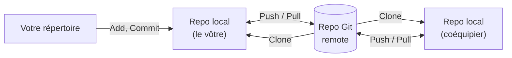
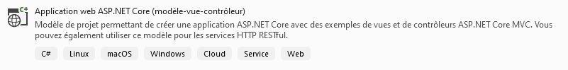
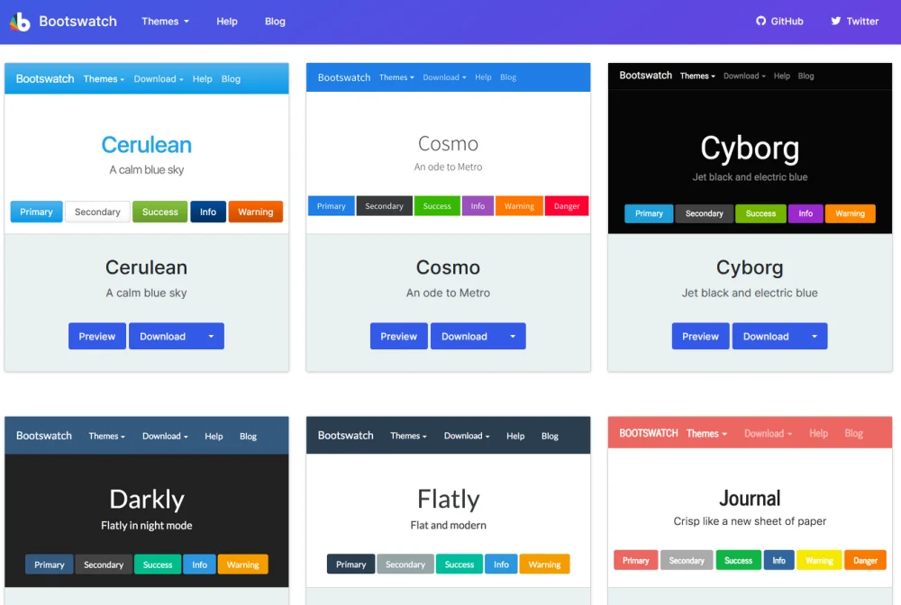

# Plan de cours, Git et projets MVC

## Contenu: 
- Plan de cours 
- Git/GitHub/Fork (théorie)
  - Repository 
  - Commit 
  - Création d’un Repo GitHub pour les démonstrations 
- .NET Core MVC : Projets 
  - Création de projet .NET Core MVC (avec liste comme en 2W6) 
  - Déclenchement d’action et d’événement au niveau de l’application par l’envoi d’un formulaire ou d’un appel de page.

## Ressources et documentation: 
- [Consignes/standards Repositories et Commits](https://info.cegepmontpetit.ca/git)
- [Bootswatch](https://bootswatch.com/)
- [Bootstrap DropDown Menu](https://getbootstrap.com/docs/5.0)

#### Complémentaire 
- [Standards C# Microsoft](https://docs.microsoft.com/en-us/dotnet/csharp/programming-guide/inside-a-program/coding-conventions)
- [Standards C#](https://github.com/ktaranov/naming-convention/blob/master/C%23%20Coding%20Standards%20and%20Naming%20Conventions.md)

## Activités de la séance

### Théorie:
- 🔗[Notes de cours](#notes-de-cours) (ci-dessous)
- 🔗[420_3W6_cours_01_Git_Révision.pptx](../assets/cours/presentations/420_3W6_cours_01_Git_Révision.pptx) (présentation originale)
- 🔗[Aide GitHub](/autres/gitHub)
- 🔗[Aide Fork](/autres/fork)

### Laboratoires:

Utilisation de Fork (Toute la classe ensemble)
  - L'exercice est à la fin des notes de cours : [Démo GitHub/Git/Fork](#démo-githubgitfork)
  - Les deux autres documents de théorie fournissent l'information nécessaire pour faire l'exercice


#### GitHub FORK le repo suivant
- Révision 🔗[S01_Lab1_Révision](https://github.com/A26ProgWebTrans/S01_Lab2_Revision)


### Travail personnel: 
- Compléter les laboratoires

---

## Notes de cours

### Contenu du cours
- Plan de cours
- Présentation de l’enseignant
- [Les défis du cours](#les-défis-du-cours)
- [Fork](#fork)
- [Révision MVC](#création-dun-projet-net-core-mvc)
- [Pourquoi .NET MVC?](#pourquoi-net-core-mvc)
- [Site Web du cours](#communications)

### Nombre d’heures par semaine
- 2 heures de théorie
- 4 heures de pratique
- 3 heures de travail personnel

### Communications
- [Site 3W6-Web-Transactionelle](https://info.cegepmontpetit.ca/3W6-Web-Transactionelle/)

### Pourquoi .NET Core MVC?
Est-ce que c’est un bon « framework »?

Mais avant… est-ce qu’un bateau, c’est un bon moyen de transport?


#### Ce que .NET Core MVC fait bien
- Sites où la logique est exécutée sur le serveur
- Génération de pages CRUD
- Interaction entre le modèle de données et la BD (avec Entity Framework)
- Validations des données sur 3 niveaux en utilisant les annotations (client/serveur/BD)

C’est donc un très bon outil pour faire de la configuration et/ou un grand nombre d’applications plus statiques.

#### Ce que .NET Core MVC fait MOINS bien
- Client dynamique avec de la logique exécutée sans appel au serveur (utilisation de JavaScript pour le faire)
- Gestion des dépendances (librairies)

### Les défis du cours
- Combinaison de BD et de web (plus complexe)
- Travaux pratiques (TPs) plus élaborés
- Apprentissage de JavaScript
- Plusieurs cas où les erreurs sont difficiles à diagnostiquer (conflits de librairies, mauvaises configurations, authentification)

:::tip LA solution
Ne prenez pas de retard dans vos TPs. Si vous avez l’habitude de tout faire la veille de la remise, vous risquez d’avoir une mauvaise surprise!
:::

### La bonne nouvelle
Après ce cours, vous pourrez créer des applications complètes qui ont de la valeur!

> 🗄️ BD + 🌐 Web = 💰

### Git
- Pas un serveur, ni un client
- Permet de gérer des repositories
- Plusieurs copies du même repository (Clone)
- Commit
- Push et Pull (gestion de conflits)
- Branches

#### Les commandes Git
| Commande | Description |
|---|---|
| `git add` | Ajouter un fichier (pour éventuellement faire partie d’un commit) |
| `git commit [-m "commentaire"]` | Créer un commit avec l’ensemble des fichiers ajoutés |
| `git pull` | Récupérer les changements sur le repository du serveur |
| `git push` | Envoyer les changements sur le repository du serveur |

#### Gitignore
- Il est possible d’ajouter UN ou plusieurs fichiers `.gitignore` à un projet
- Permet d’avoir des fichiers locaux qui ne sont pas « gérés » par Git
- Important pour les répertoires temporaires d’un projet (peuvent devenir très gros!)
- La bonne nouvelle : un fichier `.gitignore` est généré lors de la création d’un projet .NET Core MVC et il exclut déjà les fichiers temporaires

:::tip
S’il n’y a pas encore de `.gitignore` (par exemple, si le repository a été créé sans en ajouter un), on peut générer celui de .NET avec la commande suivante dans un terminal, à la racine du repository :

```bash
dotnet new gitignore
```
:::

Voici un extrait typique d’un `.gitignore` pour un projet .NET (semblable à ce que génère `dotnet new gitignore`) :

```gitignore title=".gitignore"
# Fichiers compilés : régénérés à chaque build, inutile de les partager
[Bb]in/
[Oo]bj/

# Configuration locale de Visual Studio (propre à chaque développeur)
.vs/
*.user

# Paquets NuGet téléchargés : restaurés automatiquement avec dotnet restore
packages/

# Fichiers de base de données locaux (LocalDB)
*.mdf
*.ldf
```

- Une ligne qui se termine par `/` ignore un **répertoire** au complet (ex. : `bin/`).
- `*` remplace n’importe quelle suite de caractères (ex. : `*.user` ignore tous les fichiers qui finissent par `.user`).
- `[Bb]` accepte l’une ou l’autre des lettres, donc `bin/` et `Bin/` sont ignorés.
- Une ligne qui commence par `#` est un commentaire.

#### Git 🚫 (À éviter!)
- Toute opération qui inclut le mot « Force »
- Rebase

:::danger
Dans les deux cas, vous pouvez perdre des données de façon définitive! En utilisant uniquement des merges, on pourra toujours récupérer les différentes versions qui ont existé.
:::

### GitHub
- Serveur qui contient la copie principale des repositories
- Offre de nombreuses fonctionnalités pour améliorer la collaboration
  - Contrôle d’accès
  - Pull Requests
  - Revues de code

### Utilisation de Git



### Fork
- Interface graphique pour utiliser Git
- Il y a plusieurs autres options, mais Fork est un bon outil qui va être utilisé dans tous les cours de la technique. Il remplace GitKraken avec lequel on avait fréquemment des problèmes de licence.

#### GitKraken
- Une autre interface graphique pour utiliser Git
- Les exemples du cours vont utiliser Fork, mais si vous préférez utiliser GitKraken, vous êtes libres de le faire!

### 🚫 Ne pas cloner dans OneDrive!!! 🚫

:::warning Pourquoi?
Pour la même raison que l’on ne va pas mettre des projets de programmation en général sur OneDrive (oui, je pense à toi `npm install`).

- Ces projets génèrent un grand volume de données, souvent plusieurs centaines de Mo. Et ces données sont fréquemment contenues dans des milliers de petits fichiers qui rendent OneDrive vraiment très lent.
- Au fond, c’est essentiellement le même problème qu’avec Git si on n’utilise pas de fichier `.gitignore`.
- Et comme les fichiers sont déjà sauvegardés sur GitHub, ce n’est pas utile de les conserver sur OneDrive en plus!
:::

### Démo GitHub/Git/Fork
Nous allons faire une série d’exercices pour apprendre à utiliser GitHub et Fork.

:::info ATTENTION
À la fin des exercices, vous allez me partager votre travail pour que je puisse vérifier que vous êtes tous capables de bien utiliser ces outils!
:::

#### Exemple de base
1. Création d’un repository sur GitHub : « ForkThat »
1. Ajouter notre compte GitHub dans Fork
1. Cloner dans un répertoire (le bureau, c’est parfait)
1. Ajouter un fichier `test.txt` avec un peu de texte : « Texte que je partage avec le prof »
1. Faire un commit qui inclut le fichier
1. Regarder sur GitHub dans Code (on espère qu’il n’y a pas encore le fichier `test.txt`)
   - **Question :** le commit est où?
1. Faire un push
1. Regarder dans GitHub encore (on espère que le fichier est là!)
1. Modifier le fichier en ajoutant le texte « plus de texte » au fichier `test.txt`
1. Faire un commit ET un push
1. Regarder l’historique sur GitHub

#### Tester le .gitignore
1. Créer un répertoire `/bin`
1. Ajouter un fichier `fichierInvisiblePourGit.txt`
1. Vérifier que le fichier n’apparaît PAS dans les « local changes »

#### Création de branches
1. Création de la branche « test » (avec checkout)
1. Modification au fichier `test.txt`, ajout du texte « changement dans une branche »
1. Commit
1. Push
1. Regarder sur GitHub
1. Retour dans la branche `main`
1. Merge de la branche `test` dans la branche `main`
1. Commit
1. Regarder sur GitHub

#### Exemple de travail à la maison (clone)
1. Cloner ForkThat dans un répertoire qui se nomme ForkThatTwo (ça représente le travail à la maison)
1. Faire un changement
1. Faire un commit
1. Faire un push
1. Vérifier que le repository ForkThat n’a pas encore le changement
1. Faire un « Pull » pour obtenir les changements et avoir les bonnes données

:::tip En résumé
La bonne façon de faire quand on a déjà cloné le repository? Il faut faire un « Pull » avant de commencer à travailler pour obtenir la dernière version avant de faire nos nouveaux changements!
:::

### Création d’un projet .NET Core MVC



### Les éléments importants d’un projet .NET Core MVC
| Élément | Rôle |
|---|---|
| `Program.cs` | Configuration de l’application, entre autres d’Entity et d’Identity<br/>Enregistrement des services<br/>Démarrage |
| `wwwroot` | Fichiers statiques du site : CSS, JS, images |
| `_Layout.cshtml` | Mise en page de base partagée par toutes les pages<br/>Ajout de certaines librairies comme Bootstrap et jQuery |
| `DbContext.cs` | Contexte de la BD qui contient les DbSets des classes qui vont être gérées par Entity |
| `appsettings.json` | Information de connexion pour la BD<br/>Clés d’API<br/>Information sur les niveaux de logging |

### Librairie Bootswatch
- [Bootswatch](https://bootswatch.com/)


