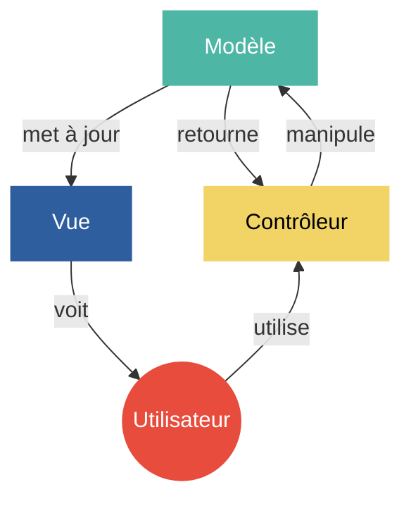
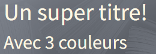
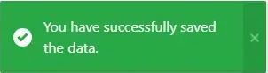
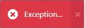
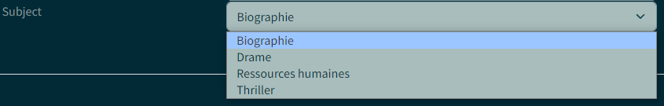
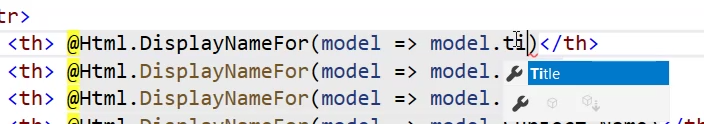

import Laboratoire from '/laboratoire.mdx';

# Vues, ViewModels et validation

## Contenu
- .NET Core MVC : Projets suite 
  - Views 
  - Views Models 
- Validation de base (rappel de 2W6) 
  - Niveaux 
  - Annotations de validation 
  - TagHelpers 


## Ressources et documentation: 
#### Complémentaire: 
- [Standards C# Microsoft](https://docs.microsoft.com/en-us/dotnet/csharp/programming-guide/inside-a-program/coding-conventions)
- [Standards C#](https://github.com/ktaranov/naming-convention/blob/master/C%23%20Coding%20Standards%20and%20Naming%20Conventions.md)
- [Raccourcis Visual Studio](#raccourcis-visual-studio)

## Activités de la séance: 

### Théorie
- 🔗[Notes de cours](#notes-de-cours) (ci-dessous)
- 🔗[420_3W6_cours_02_Data_Validtions_Annotations.pptx](../assets/cours/presentations/420_3W6_cours_02_Data_Validtions_Annotations.pptx) (présentation originale)
- 🔗[Démo Validation](https://github.com/A26ProgWebTrans/S02_DemoValidations)

### Laboratoire
#### GitHub FORK le repo suivant

- Labo 🔗[S02_Lab1_ViewModels](https://github.com/A26ProgWebTrans/S02_Lab1_ViewModels)


### Travail personnel: 
- Compléter le laboratoire

---

## Notes de cours

### Contenu du cours
- [Communiquer des données vers une vue](#communication-contrôleur--vue)
- [ViewModel](#viewmodel)
- [Annotations et validations](#annotations)
- [Validation sur le client](#validation-dans-le-navigateur)
- [Plus d’info sur les annotations](#les-errormessages-sont-paramétrables)

### Patron MVC



### Communication Contrôleur → Vue
Il existe 4 techniques pour communiquer des données d’un contrôleur vers une vue :
- ViewData
- ViewBag
- TempData
- Modèle

Ces techniques peuvent être utilisées en même temps.

#### ViewData
- C’est la façon originale de communiquer de l’information.
- Simplement un dictionnaire que l’on remplit avec des données dans le contrôleur.
- À éviter sauf dans les cas très simples où l’on veut simplement communiquer des strings, car sinon il faut faire des « casts » pour indiquer le type du contenu.

```csharp title="Contrôleur"
this.ViewData["titre"] = "Un super titre!";

List<string> couleurs = new List<string>()
{
    "Rouge",
    "Vert",
    "Bleu"
};

this.ViewData["couleursData"] = couleurs;
```

```cshtml title="Vue"
<h1>@ViewData["titre"]</h1>

<h2>Avec @((ViewData["couleursData"] as List<string>).Count) couleurs</h2>
```



#### TempData
- C’est une variation de ViewData avec une durée de vie différente.
- La donnée est conservée tant qu’elle n’est pas lue. On peut la lire lors d’une prochaine requête ou au travers d’une redirection.
- Dans ce cours, c’est surtout pratique pour afficher des messages lors d’un évènement.




#### ViewBag
C’est une amélioration de ViewData qui permet d’éviter d’avoir à faire des « casts » lorsque l’on accède aux objets dans la vue.

```csharp title="Contrôleur"
this.ViewData["titre"] = "Un super titre!";

this.ViewBag.Couleurs = new List<string>()
{
    "Rouge",
    "Vert",
    "Bleu"
};
```

```cshtml title="Vue"
<h1>@ViewData["titre"]</h1>

// Avec un @ViewBag, on peut accéder à la propriété Count
// de la liste Couleurs sans faire de cast
<h2>Avec @ViewBag.Couleurs.Count couleurs</h2>
```

#### ViewBag pour un menu de sélection
Dans ce cours, on l’utilise surtout pour des menus de sélection.

```csharp title="Contrôleur"
public IActionResult Create()
{
    ViewBag.Subjects = new SelectList(_database.Subjects.OrderBy(s => s.Name).ToList(), "Id", "Name", null);

    return View();
}
```

```cshtml title="Vue"
<div class="col-8">
    <select class="form-control form-select" asp-for="Subject_Id" asp-items="@ViewBag.Subjects"></select>
    <span asp-validation-for="Subject_Id" class="text-danger"></span>
</div>
```



#### ViewBag n’est pas fortement typé!
Même si le ViewBag fonctionne mieux que ViewData, il n’est pas fortement typé et ne permet pas de valider l’accès aux données de nos vues. Il ne permet d’ailleurs pas la saisie automatique.



#### Model
- L’utilisation de modèle est la technique que nous allons favoriser dans ce cours, car elle offre de nombreux avantages.
- En utilisant les annotations, il est possible d’afficher et valider correctement les données.
- On peut utiliser le modèle de façon simple pour lire ses propriétés.

```cshtml
@model Book

<div>
    @Model.Name
</div>
```

### ViewModel
L’instruction `@model` peut être utilisée avec une classe qui fait partie de notre modèle de données. Comme la classe `Book` d’une application de gestion de livres ou la classe `Zombie` d’une application de zombies. Dans ce cas, on parle simplement d’un **Modèle** (Model).

Mais il est possible d’utiliser n’importe quelle classe lorsque l’on affiche une vue. Lorsque l’on utilise une classe que l’on a créée spécialement pour afficher une vue, on parle alors d’un **ViewModel**.

```cshtml
@model UneClassSuperSpecifiqueJustePourCetteVueVM
```

#### Pourquoi utiliser un ViewModel?
Très utile quand :
- La vue nécessite des données qui viennent de plusieurs modèles différents de notre modèle de données. Par exemple : une vue de statistiques.
- La vue a besoin d’informations supplémentaires pour s’afficher correctement. Par exemple : une vue avec plusieurs pages d’informations.
- La vue a besoin d’une toute petite partie de l’information ou de gérer de l’information temporaire. Par exemple : le changement d’un mot de passe.

#### Exemple simple de ViewModel
Si on veut permettre à un utilisateur de modifier un mot de passe avec un formulaire, les seules données que l’on veut récupérer dans cette vue sont l’ancien et le nouveau mot de passe. On peut donc définir un ViewModel simple et efficace qui contiendra nos données.

```csharp title="ChangePasswordViewModel.cs"
public class ChangePasswordViewModel
{
    [DataType(DataType.Password)]
    public string OldPassword { get; set; }

    [DataType(DataType.Password)]
    public string NewPassword { get; set; }

    [DataType(DataType.Password)]
    [Compare(nameof(NewPassword))]
    public string ConfirmPassword { get; set; }
}
```

```cshtml title="Vue"
@model ChangePasswordViewModel
```

```csharp title="Contrôleur"
public IActionResult ChangePassword()
{
    return View(new ChangePasswordViewModel());
}

[HttpPost]
public IActionResult ChangePassword(ChangePasswordViewModel passwordData)
{
    if (ModelState.IsValid)
    {
        // Modifier le Mot de passe de l'utilisateur
    }

    return this.View(passwordData);
}
```

### Annotations

#### Les annotations ont une triple fonction
- Contrôler comment la donnée est affichée
- Valider la valeur (vide, pas vide, format)
- Mettre en place les contraintes du modèle

#### Des exemples d’annotations simples
```csharp
[StringLength(42, MinimumLength = 4)]
public string Name { get; set; }

[DataType(DataType.Password)]
public string NewPassword { get; set; }

[DataType(DataType.Password)]
[Compare(nameof(NewPassword))]
public string ConfirmPassword { get; set; }
```

#### Comment gérer Required
Dans les versions précédentes de .NET Core MVC, on utilisait l’annotation `[Required]` :

```csharp
[Required]
public string Description { get; set; }
```

Le problème avec cette technique, c’est qu’elle n’est plus à jour. En effet, les propriétés sont maintenant requises (required) par défaut!

La nouvelle façon de faire, c’est d’ajouter un `?` lorsqu’une propriété n’est **PAS** requise. Dans le cas suivant, `Description` est requise et `Description2` est optionnelle.

```csharp
public string Description { get; set; }

public string? Description2 { get; set; }
```

#### Les ErrorMessages sont paramétrables
```csharp
[Display(Name = "Nombre de pièces")]
[Range(1, int.MaxValue, ErrorMessage = "Il faut un minimum de 1 pièce.")]
```

Dans le cas de `Range`, il y a 3 valeurs disponibles pour afficher dans notre message d’erreur :
- `{0}` : Nombre de pièces (le descriptif de la propriété)
- `{1}` : 1 (le premier paramètre de l’attribut)
- `{2}` : 2147483647 (le deuxième paramètre de l’attribut)

On pourrait donc mettre un message comme ceci :

```csharp
[Display(Name = "Nombre de pièces")]
[Range(1, int.MaxValue,
ErrorMessage = "Le champ {0} demande un minimum de {1} pièce et doit être positif.")]
```

Le message de validation serait alors : « Le champ Nombre de pièces demande un minimum de 1 pièce et doit être positif. »

:::tip
On évite d’avoir un message d’erreur qui n’est pas à jour!!
:::

### Validation

#### Les trois niveaux de validation
1. **Navigateur (client)** : pour l’affichage des erreurs et éviter des requêtes inutiles au serveur.
2. **Application Web (serveur)** : pour l’intégrité des données et les règles d’affaires.
3. **BD** : pour l’intégrité des données.

Ce sont les 3 niveaux de protection disponibles pour éviter de corrompre nos données. La validation est faite dans cet ordre et c’est préférable de détecter l’erreur le plus rapidement possible.

#### La validation multi niveaux
| Niveau | Quand | Outils | En cas d’erreur |
|---|---|---|---|
| Navigateur (client) | Validation avant l’envoi du formulaire | [Types d’entrée](https://www.w3schools.com/tags/att_input_type.asp), [jquery.validation](https://jqueryvalidation.org/documentation/), [Remote Attribute](https://docs.microsoft.com/fr-fr/aspnet/core/mvc/models/validation?view=aspnetcore-10.0#remote-attribute) | Affichage des erreurs. S’il y a une erreur à ce niveau, aucun appel n’est fait vers le serveur. |
| Application Web (serveur) | Validation à la création de l’objet modèle avec le résultat dans le ModelState! | [ModelState](https://learn.microsoft.com/fr-fr/dotnet/api/microsoft.aspnetcore.mvc.modelbinding.modelstatedictionary?view=aspnetcore-10.0) | Retour de la vue avec le dictionnaire d’erreurs : si `ModelState.IsValid` n’est pas valide, on retourne la vue avec les erreurs dans le ModelState! |
| BD | Contraintes BD | NOT NULL vs NULL, grandeur du champ, clés étrangères, clés primaires | Exception par rapport aux contraintes BD : `DbUpdateException`, `DbUpdateConcurrencyException` |

#### Validation dans le navigateur
La logique de validation vient d’une librairie JavaScript et donc d’un script. Cette référence est habituellement sous `/Shared/`, nommée `_ValidationScriptsPartial`. Il faut donc l’ajouter dans les vues avec validation si elle n’est pas là.

```cshtml
@section Scripts {
    @{await Html.RenderPartialAsync("_ValidationScriptsPartial");}
}
```

#### Validation sur le serveur
- Le `ModelState` est populé dans le contrôleur.
- Le ModelBinding est la création d’un objet et le mapping des informations de la requête dans l’objet.
- Lorsque c’est invalide, il faut retourner la vue avec le formulaire pour afficher les erreurs!

```csharp
//GET CREATE
public IActionResult Create()
{
    return View();
}

//POST CREATE
[HttpPost]
public IActionResult Create(Book book)
{
    if (ModelState.IsValid)
    {
        // Valide
        _database.Books.Add(book);
        return this.RedirectToAction("Index");
    }
    // Invalide
    return this.View(book);
}
```

#### Validation BD
Si un appel à `db.SaveChanges();` est fait alors que les données ne sont pas valides, la méthode va émettre une exception.

#### Démo de validation
Voici le modèle que nous allons utiliser pour comprendre comment l’erreur est gérée dans les 3 niveaux.

```csharp
public class MonModel
{
    public int Id { get; set; }

    [Range(3, 10, ErrorMessage = "Le champ {0} doit être entre {1} et {2}")]
    public int Valeur { get; set; }

    [Required(ErrorMessage = "Un message spécifique pour dire que c'est requis!")]
    public string Requis { get; set; }

    [StringLength(30, MinimumLength = 5)]
    public string? Optionnel { get; set; }
}
```

#### Autres validations
Vous pouvez ajouter des erreurs au `ModelState` « manuellement » dans votre contrôleur pour vous permettre d’afficher un message d’erreur dans une condition particulière.

```csharp
this.ModelState.AddModelError(e.Property, e.Message);
```

Dans notre vue, on peut ensuite afficher le message d’erreur d’une propriété de cette façon :

```cshtml
@Html.ValidationMessageFor(model => Model.Name)
```

Si c’est une erreur qui n’est pas associée à une propriété du modèle, on l’affiche comme ça :

```cshtml
@Html.ValidationMessage("ErreurDeMonChoix", new { @class = "text-warning" })
```

Le 2e paramètre peut être utilisé dans les deux méthodes et permet de spécifier l’attribut « class » de l’élément qui affiche le message.

#### Validation du modèle
Finalement, vous pouvez faire implémenter l’interface `IValidatableObject` à une classe modèle afin d’écrire votre propre logique de validation.

```csharp
public IEnumerable<ValidationResult> Validate(ValidationContext validationContext)
{
    if (Genre == Genre.Classic && ReleaseDate.Year > _classicYear)
    {
        yield return new ValidationResult(
            $"Classic movies must have a release year no later than {_classicYear}.",
            new[] { nameof(ReleaseDate) });
    }
}
```

#### La validation du modèle, étape par étape
1. Le contrôleur fournit une vue avec un objet null (valide).
2. Le formulaire a été rempli et envoyé jusqu’au serveur et un objet est créé à partir des données des inputs du formulaire.
3. Si `ModelState` est valide, l’objet est ajouté à la BD et on navigue vers la page Index.
4. S’il est invalide, une nouvelle vue est créée avec l’objet `Book`, ce qui permet de conserver les données déjà entrées.

```csharp title="Contrôleur"
//GET CREATE
public IActionResult Create()
{
    return View();
}

//POST CREATE
[HttpPost]
public IActionResult Create(Book book)
{
    if (ModelState.IsValid)
    {
        // Valide
        _database.Books.Add(book);
        return this.RedirectToAction("Index");
    }
    // Invalide
    return this.View(book);
}
```

```cshtml title="Vue"
<div class="col-2">
    <label asp-for="Name"></label>
</div>

<div class="col-8">
    <input asp-for="Name" class="form-control" />
    <span asp-validation-for="Name" class="text-danger"></span>
</div>
```

## Raccourcis Visual Studio

Source : [Visual Studio Keyboard shortcuts (PDF, Microsoft)](https://visualstudio.microsoft.com/keyboard-shortcuts.pdf)

### Édition de code
| Raccourci | Action |
|---|---|
| `Ctrl + Espace` | Compléter le mot |
| `Ctrl + Shift + Espace` | Afficher l'aide sur la signature |
| `Alt + ↑ / ↓` | Déplacer la ligne vers le haut / bas |
| `Ctrl + D` | Dupliquer la ligne |
| `Ctrl + Shift + L` | Supprimer la ligne |
| `Ctrl + Entrée` | Insérer une ligne en dessous |
| `Ctrl + Shift + Entrée` | Insérer une ligne au-dessus |
| `Ctrl + ↑ / ↓` | Défiler d'une ligne vers le haut / bas |
| `Ctrl + PgUp / PgDn` | Défiler d'une page vers le haut / bas |
| `Shift + molette de la souris` | Défiler horizontalement |
| `Ctrl + /` | Commenter / décommenter la ligne |
| `Ctrl + Shift + /` | Commenter / décommenter le bloc |
| `Ctrl + K + D` | Formater le document |
| `Ctrl + K + F` | Formater la sélection |
| `Alt + /` | Demander à Copilot (clavardage en ligne) |
| `Ctrl + E + W` | Activer / désactiver le retour automatique à la ligne |
| `Ctrl + R + W` | Afficher / masquer les espaces blancs |
| `Shift + Alt + L + S` | Trier les lignes |
| `Shift + Alt + L + J` | Joindre les lignes |

### Rechercher et remplacer
| Raccourci | Action |
|---|---|
| `Ctrl + F` | Rechercher |
| `Ctrl + H` | Remplacer |
| `Ctrl + Shift + F` | Rechercher dans les fichiers |
| `Ctrl + Shift + H` | Remplacer dans les fichiers |
| `F8 / Shift + F8` | Aller à l'erreur suivante / précédente |

### Refactorisation
| Raccourci | Action |
|---|---|
| `Ctrl + .` ou `Alt + Entrée` | Afficher les actions rapides |
| `Ctrl + R + M` | Extraire une méthode |
| `Ctrl + R + I` | Extraire une interface |
| `Ctrl + R + R` | Renommer |
| `Ctrl + R + G` | Supprimer et trier les `using` |
| `Ctrl + K + E` | Nettoyage du code |
| `Ctrl + K + S` | Entourer de (`if`, `try`, etc.) |
| `Shift + Alt + L + S` | Trier les lignes |
| `Shift + Alt + L + J` | Joindre les lignes |

### Navigation
| Raccourci | Action |
|---|---|
| `Ctrl + Q` ou `Ctrl + Shift + P` | Rechercher une fonctionnalité |
| `Ctrl + T` | Rechercher dans le code |
| `Ctrl + G` | Aller à la ligne |
| `F8 / Shift + F8` | Aller à l'erreur suivante / précédente |
| `F12` | Atteindre la définition |
| `Alt + F12` | Aperçu de la définition |
| `Ctrl + F12` | Atteindre l'implémentation |
| `Shift + F12` | Rechercher toutes les références |
| `Alt + Début` | Aller à la classe de base |
| `Ctrl + -` / `Ctrl + Shift + -` | Naviguer vers l'arrière / l'avant |
| `Ctrl + Shift + Retour arrière` | Aller au dernier emplacement modifié |
| `Ctrl + Shift + ↑ / ↓` | Aller à la référence suivante / précédente |
| `Ctrl + K + K` | Ajouter / retirer un signet |
| `Ctrl + K + N / P` | Aller au signet suivant / précédent |
| `Ctrl + K + L` | Effacer tous les signets |

### Débogage
| Raccourci | Action |
|---|---|
| `F5` | Démarrer / continuer le débogage |
| `Shift + F5` | Arrêter le débogage |
| `Ctrl + F5` | Exécuter sans débogage |
| `F9` | Ajouter / retirer un point d'arrêt |
| `Ctrl + Shift + F9` | Supprimer tous les points d'arrêt |
| `F10` | Pas à pas principal |
| `F11` | Pas à pas détaillé |
| `Shift + F11` | Pas à pas sortant |
| `Ctrl + Alt + P` | Attacher au processus… |
| `Shift + Alt + P` | Rattacher au processus |
| `Alt + F2` | Lancer le profileur |
| `Shift + Alt + F2` | Relancer le profileur |

### Curseurs multiples et sélection
| Raccourci | Action |
|---|---|
| `Ctrl + Alt + clic de souris` | Insérer un curseur |
| `Shift + Alt + .` | Insérer un curseur à la prochaine occurrence |
| `Shift + Alt + ;` | Insérer un curseur à toutes les occurrences |
| `Shift + Alt + ,` | Retirer le dernier curseur |
| `Shift + Alt + /` | Déplacer le dernier curseur vers le bas |
| `Shift + Alt + ↑ / ↓` | Sélection en colonne (rectangulaire) |
| `Alt + glisser la souris` | Sélection en colonne (rectangulaire) |
| `Shift + Alt + = / -` | Étendre / réduire la sélection |

### Projets et solutions
| Raccourci | Action |
|---|---|
| `Ctrl + Shift + N` | Nouveau projet |
| `Ctrl + Shift + O` | Ouvrir un projet |
| `Ctrl + B` | Générer la sélection |
| `Ctrl + Shift + B` | Générer la solution |
| `Ctrl + Shift + A` | Ajouter un nouvel élément |
| `Shift + Alt + A` | Ajouter un élément existant |
| `Shift + F2` | Ajout rapide d'un élément |
| `Alt + Entrée` | Propriétés |

### Gestion des fichiers
| Raccourci | Action |
|---|---|
| `Ctrl + N` | Nouveau fichier |
| `Ctrl + O` | Ouvrir un fichier |
| `Ctrl + Shift + S` | Tout enregistrer |
| `Ctrl + Alt + PgUp / PgDn` | Aller au document à gauche / droite |
| `Ctrl + F4` | Fermer l'onglet |
| `Ctrl + K + Z` | Rouvrir les onglets fermés |
| `Ctrl + [ + S` | Afficher le fichier actif dans l'Explorateur de solutions |
| `Ctrl + Tab` | Parcourir les onglets |
| `F7 / Shift + F7` | Basculer entre le concepteur et le code |
| `F4` | Propriétés |

### Fenêtres et affichage
| Raccourci | Action |
|---|---|
| `Shift + Alt + Entrée` | Plein écran |
| `Ctrl + double-clic sur la fenêtre` | Basculer vers le dernier emplacement ancré / flottant |
| `Ctrl + Alt + 1-9` | Changer de disposition de fenêtres enregistrée |
| `Shift + Échap` | Fermer la fenêtre d'outil active |
| `Ctrl + Alt + L` | Ouvrir l'Explorateur de solutions |
| `Ctrl + \ + C` | Ouvrir le clavardage GitHub Copilot |
| `Ctrl + \ + E` | Ouvrir la liste d'erreurs |
| `Ctrl + Alt + O` | Ouvrir la fenêtre Sortie |
| `Échap` | Remettre le focus sur l'éditeur |

### Git
| Raccourci | Action |
|---|---|
| `Alt + G + C` | Fenêtre Modifications Git |
| `Alt + G + M` | Fenêtre Dépôt Git |
| `Ctrl + Alt + F3` | Sélecteur de branche |
| `Ctrl + Alt + F4` | Sélecteur de dépôt |
| `Ctrl + E + C` | Menu des actions Git |
| `Ctrl + Entrée` | Commit |

### Tests unitaires
| Raccourci | Action |
|---|---|
| `Ctrl + E + T` | Explorateur de tests |
| `Ctrl + R + A` | Exécuter tous les tests |
| `Ctrl + R + L` | Répéter la dernière exécution |
| `Ctrl + R + U` | Exécuter jusqu'à l'échec |
| `Ctrl + R + F` | Exécuter les tests échoués |
| `Ctrl + R + N` | Exécuter les tests non exécutés |
| `Ctrl + R + Suppr` | Effacer tous les résultats |
