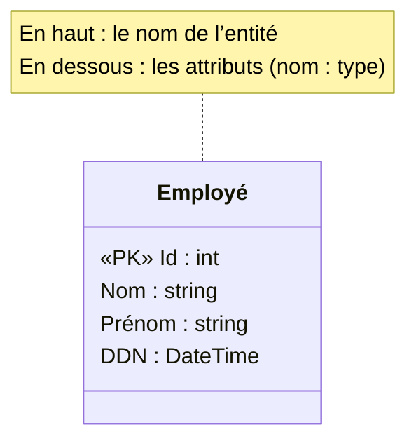
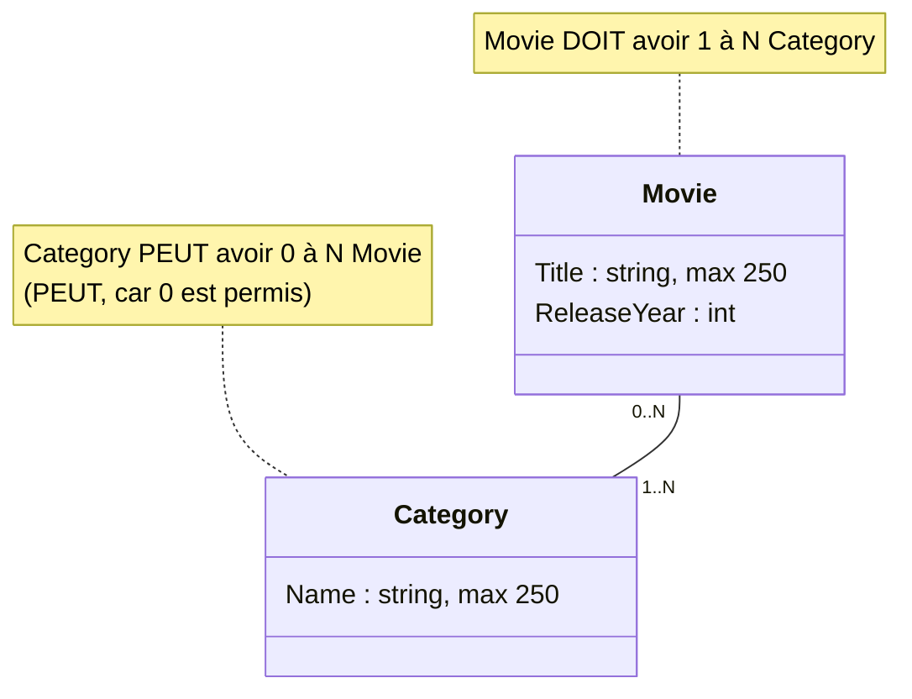
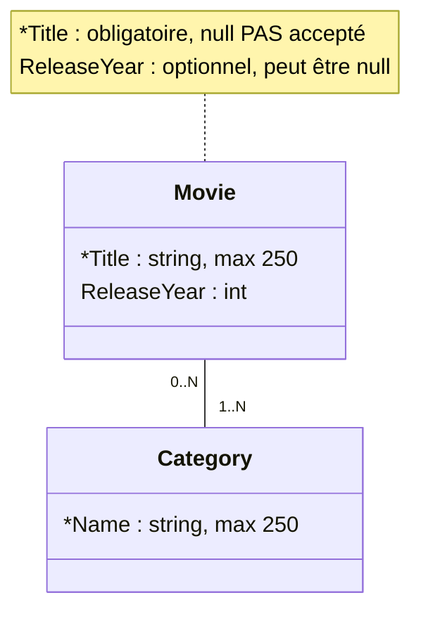
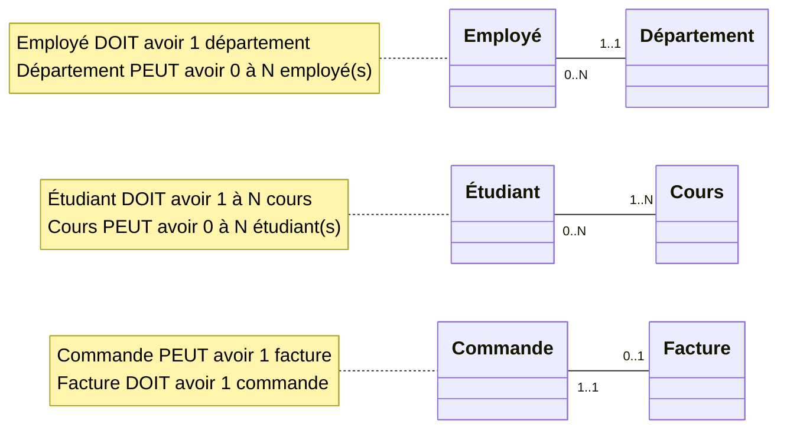
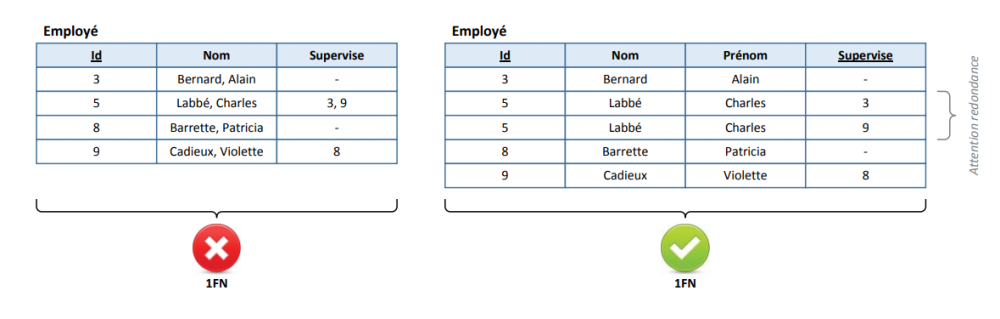
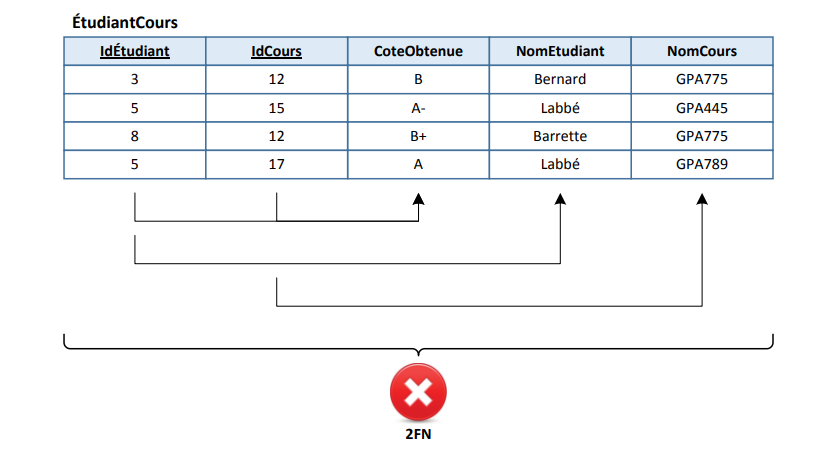
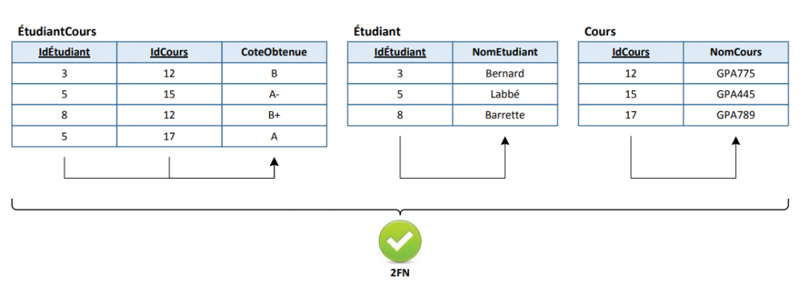

import Laboratoire from '/laboratoire.mdx';

# Modélisation BD et UML

## Contenu
- Rappel cours de BD et plus : 
  - Modélisation BD, liaisons 
  - Modèles de classes simples  
  - Diagrammes de classes UML

## Activités de la séance: 
### Théorie
- Wooclap!
- 🔗[Notes de cours](#notes-de-cours) (ci-dessous)
- 🔗[420_3W6_cours_03_Modélisation.pptx](../assets/cours/presentations/420_3W6_cours_03_Modélisation.pptx) (présentation originale)

### Laboratoire
#### GitHub FORK Laboratoire

- Labo 🔗[S03_Lab1_Modelisation](https://github.com/A26ProgWebTrans/S03_Lab1_Modelisation)


### Travail personnel: 
- Compléter le laboratoire

---

## Notes de cours

### Contenu du cours
- [Code First](#code-first)
- [Modèles de classe](#modèles-de-classe)
- [Relations](#relations-dans-un-diagramme-uml)
- [Normalisation](#normalisation)

### Code First
L’expression « Code First », par opposition à « DB First », indique que l’on écrit d’abord notre code et que l’on génère ensuite la base de données à partir du code écrit.

Dans ce cours, on écrit les classes de notre modèle de données et on génère des instructions SQL pour mettre à jour notre BD.

:::info
Entity Framework permet également de faire du DB First. Dans ce cas, on peut générer des classes à partir d’une BD déjà existante. C’est très intéressant quand on veut utiliser un ORM avec la BD d’une application déjà existante!
:::

### Modèles de classe
On peut représenter nos données de plusieurs façons :
- Code SQL
- Code C#
- Diagramme UML



:::info
La clé primaire est identifiée avec le stéréotype `«PK»` (Primary Key) devant l’attribut. On voit aussi parfois la notation `{PK}` après le type. L’attribut `Id` est optionnel dans le diagramme, car Entity Framework le reconnaît par convention.
:::

### Relations dans un diagramme UML
- On peut indiquer les relations entre nos classes dans notre diagramme.
- Il n’est pas nécessaire d’afficher les clés étrangères dans les attributs de notre diagramme.



### La cardinalité
La cardinalité permet d’identifier le nombre possible d’instances auxquelles une instance est reliée.

On doit la lire de la façon suivante : « Movie peut/doit avoir (le chiffre à l’autre bout de la relation) Category ».

| Symboles | Définition |
|---|---|
| `0..1` | 0 ou 1 (optionnel) |
| `1..1` | 1 (obligatoire) |
| `0..N` / `0..*` | 0 à plusieurs (optionnel) |
| `1..N` / `1..*` | 1 à plusieurs (obligatoire) |

:::warning Important
La cardinalité représente les valeurs minimales et maximales qui sont possibles pour notre modèle de données **en tout moment**. Pas simplement ce qui est « habituel ».

Si on mettait un 1 à la place du zéro dans notre exemple, il ne serait pas possible de créer une nouvelle catégorie si elle n’était pas déjà associée à au moins un Movie. Ça risquerait de rendre la création de la Category plus complexe!
:::

### Annotation pour un champ obligatoire
Pour spécifier qu’un champ est obligatoire, on utilise le symbole `*`.



Pour représenter correctement les données dans notre code, on va utiliser un `?` pour les types qui n’ont PAS de `*`. Car le `?` permet justement à une donnée comme un `int` d’avoir la valeur null (vu au cours précédent).

```csharp
public class Movie
{
    [StringLength(250)]
    public string Title { get; set; }
    public int? ReleaseYear { get; set; }
}
```

### Autres annotations
Il existe d’autres annotations que l’on peut ajouter à notre diagramme UML. On peut par exemple mentionner la visibilité d’une propriété. Comme ce cours se concentre surtout sur les relations entre les objets, l’utilisation de ces symboles n’est pas nécessaire.

| Symboles | Correspondance |
|---|---|
| `+` | Public |
| `-` | Privé |
| `#` | Protégé |
| `~` | Paquetage |
| `/` | Dérivé |
| <u>souligné</u> | Statique |

### Exemples de relations



### Relation N à N
- Lorsque l’on a une relation avec `x..N` de CHAQUE côté, on a alors une relation N à N.
- Pour représenter une relation N à N, on a besoin d’une table intermédiaire.
- Avec Entity Framework, l’ORM que nous allons utiliser pour ce cours, la table intermédiaire peut être générée automatiquement.
- MAIS, il faut générer une classe manuellement lorsque l’on veut ajouter de l’information à la relation. Par exemple : si on a une classe `Etudiant` et une classe `Cours` et que l’on veut également stocker le résultat de l’étudiant pour le cours auquel il est inscrit, on va créer une classe `EtudiantCours` avec un attribut `Note` en plus des clés `CoursId` et `EtudiantId`.

Plus de détails au prochain cours!

### Normalisation

#### Pas de listes! (1FN)
On veut que tous les attributs soient atomiques (valeur scalaire, indivisible), donc pas de listes!



:::note
La solution à droite n’est toujours pas optimale, car les données se répètent.
:::

#### Attention aux clés composées (2FN)


Dans ce cas, la clé composée IdÉtudiant + IdCours est utile pour contenir la CoteObtenue, mais les autres informations dépendent d’une seule partie de la clé composée et l’information est donc répétée.

**Solution :**



### Bibliographie
- [https://cours.etsmtl.ca/gpa775/Cours/P05_2.pdf](https://cours.etsmtl.ca/gpa775/Cours/P05_2.pdf)
