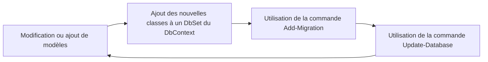

import Laboratoire from '/laboratoire.mdx';

# ORM et Entity Framework

## Contenu
- ORM
- Entity Framework 

## Ressources et documentation: 
- [Types de données SQL Server](https://docs.microsoft.com/fr-fr/sql/connect/jdbc/understanding-data-type-differences?view=sql-server-ver15)
#### Complémentaire: 
- [MSDN EF BD supportées](https://docs.microsoft.com/fr-fr/ef/core/providers/?tabs=dotnet-core-cli)
- [MSDN EF Installation et principales commandes](https://docs.microsoft.com/fr-fr/ef/core/get-started/overview/first-app?tabs=visual-studio)

## Activités de la séance: 
### Théorie:  
- 🔗[Notes de cours](#notes-de-cours) (ci-dessous)
- 🔗[420_3W6_cours_04_Entity_Framework.pptx](../assets/cours/presentations/420_3W6_cours_04_Entity_Framework.pptx) (présentation originale)
- 🔗[Étapes pour créer la base de données à partir du modèle de classes](/autres/creer-base-de-donnees)

### Laboratoire
#### GitHub FORK Laboratoire

- Labo 🔗[S04_Lab1_EntityFramework](https://github.com/A26ProgWebTrans/S04_Lab1_EF)


### Travail personnel: 
- Compléter le laboratoire

---

## Notes de cours

### Contenu du cours
- [ORM](#un-orm-cest-quoi)
- [Avantages et inconvénients](#avantages-et-inconvénients)
- [SQL vs EF](#sql-vs-entity-framework)
- [Les différents éléments](#les-6-pièces-du-casse-tête)
- [L’utilisation d’Entity Framework](#le-cycle-dutilisation-dentity-framework)

### Un ORM, c’est quoi?
- Un ORM (Object Relational Mapper) est utilisé pour simplifier les interactions entre une base de données (relationnelle) et des objets dans un langage de programmation orienté objet.
- L’ORM offre donc une couche de fonctionnalité qui se situe entre l’application que l’on développe et la base de données. Cette couche de fonctionnalités permet de lire, ajouter, modifier et effacer des données sans avoir à écrire la moindre requête.
- Il permet également de synchroniser le modèle de données des 2 côtés. L’ORM génère donc également les instructions pour créer, modifier et effacer les tables lorsqu’on utilise l’approche Code First.
- Il est également possible de générer et mettre à jour les classes de nos objets à partir de la structure de notre BD en utilisant l’approche BD First (pas couvert dans ce cours).

#### Spécifique à .NET Core MVC?
- L’ORM est un concept qui est utilisé dans la majorité des langages de programmation orientés objet et qui peut être connecté à la majorité des bases de données relationnelles. C’est donc un concept très utile à apprendre.
- Comme pour n’importe quel framework, il existe plusieurs technologies d’ORM, et ce, même pour un même langage.
- Pour ce cours, nous utilisons Entity Framework, qui est la solution « naturelle » lorsque l’on développe avec .NET Core MVC.

### Avantages et inconvénients
**Avantages :**
- Pas besoin d’écrire de requêtes
- Moins de code à écrire
- Moins de risque de bogues, car les frameworks sont bien testés
- Possible de changer de technologie de BD sans changer le reste de l’application

**Inconvénients :**
- Les requêtes ne sont pas toujours optimales dans des situations spécifiques

:::tip Solution optimale pour la majorité des projets?
Utiliser les fonctionnalités de l’ORM la grande majorité du temps et écrire des requêtes pour certaines actions spécifiques qui nécessitent plus de performance.
:::

### Les technologies de BD supportées
- [https://learn.microsoft.com/fr-fr/ef/core/providers/?tabs=dotnet-core-cli](https://learn.microsoft.com/fr-fr/ef/core/providers/?tabs=dotnet-core-cli)

### SQL vs Entity Framework
| SQL | Équivalence Entity Framework |
|---|---|
| Table | Classe |
| Contraintes | Attributs, Validation, Configuration du DbContext, Conventions |
| Scripts de création | Migrations |
| Système de requêtes SQL | Linq sur des DbSet qui génère du SQL |

### Les 6 pièces du casse-tête
- <iconify-icon icon="mdi:puzzle" style={{color: "#4db6a5"}}></iconify-icon> Modèles
- <iconify-icon icon="mdi:puzzle" style={{color: "#2e5e9e"}}></iconify-icon> Relations
- <iconify-icon icon="mdi:puzzle" style={{color: "#f2d466"}}></iconify-icon> DbContext
- <iconify-icon icon="mdi:puzzle" style={{color: "#e74c3c"}}></iconify-icon> DbSet&lt;&gt;
- <iconify-icon icon="mdi:puzzle" style={{color: "#8e44ad"}}></iconify-icon> Migrations
- <iconify-icon icon="mdi:puzzle" style={{color: "#e67e22"}}></iconify-icon> Configuration

### <iconify-icon icon="mdi:puzzle" style={{color: "#4db6a5"}}></iconify-icon> Modèles (règles importantes) {#modèles-règles-importantes}
Pour utiliser Entity Framework, vos classes doivent :
- Avoir une clé primaire (Id)
- Avoir des propriétés publiques (c’est valide si elles ne sont pas publiques, mais elles ne seront pas liées à votre BD!)
- Avoir un constructeur public vide (ce constructeur existe par défaut, mais seulement si aucun autre constructeur n’est défini)

Documentation : [https://docs.microsoft.com/fr-fr/ef/core/](https://docs.microsoft.com/fr-fr/ef/core/)

#### Constructeur vide
```csharp
public class ConstructeurVideExplicite
{
    // Constructeur
    public ConstructeurVideExplicite() { }

    public int Id { get; set; }
}

public class ConstructeurVideParDefaut
{
    // Un constructeur vide existe par defaut!
    public int Id { get; set; }
}
// highlight-start
// ❌ Invalide car cette classe n'a pas de constructeur public vide!
public class AutreConstructeur
{
    public AutreConstructeur(int valeur) {
        Valeur = valeur;
    }

    public int Id { get; set; }
    public int Valeur { get; set; }
}
// highlight-end
```

```csharp title="Version corrigée"
public class AutreConstructeur
{
    // highlight-start
    // Mais il faut le définir si un autre Constructeur existe!
    public AutreConstructeur() { }
    // highlight-end
    public AutreConstructeur(int valeur) {
        Valeur = valeur;
    }

    public int Id { get; set; }
    public int Valeur { get; set; }
}
```

#### Clé primaire
Si la clé primaire se nomme `Id` ou `LeNomDeVotreClasseId`, EF sait que c’est une clé primaire. C’est un standard.

```csharp
public class IdSimple
{
    // On peut mettre une annotation, mais ce n'est pas nécessaire
    public int Id { get; set; }
}

public class NomDeClasse
{
    // On peut mettre une annotation, mais ce n'est toujours pas nécessaire
    public int NomDeClasseId { get; set; }
}

public class AvecAnnotation
{
    // Pas le choix d'utiliser l'annotation Key dans ce cas!
    [Key]
    public int CeQueJeVeux { get; set; }
}
```

### <iconify-icon icon="mdi:puzzle" style={{color: "#2e5e9e"}}></iconify-icon> Relations {#relations}
On peut ajouter des relations entre nos objets de 2 façons : en ajoutant une propriété vers un autre objet ou un `IEnumerable` d’objets. On nomme ces propriétés des **propriétés de navigation**.

Dans cet exemple, on a créé une relation entre 1 Blog et plusieurs Posts.

```csharp
public class Post
{
    public int Id { get; set; }

    // Autres propriétés...

    // highlight-start
    // Propriété de navigation
    // Le nom de la propriété n'est pas important ici
    public Blog MonBlog { get; set; }
    // highlight-end
}

public class Blog
{
    public int BlogId { get; set; }

    // Autres propriétés...

    // highlight-start
    // Propriété de navigation
    // Encore une fois, le nom de la propriété n'est pas important
    IEnumerable<Post> MesPosts { get; set; }
    // highlight-end
}
```

#### Clés étrangères
Lorsque l’on ajoute une propriété qui fait référence à un autre objet, la clé étrangère est automatiquement générée. Mais c’est parfois utile d’accéder directement à la clé étrangère et, dans ce cas, on peut suivre le standard ou utiliser l’annotation.

```csharp
public class Post
{
    public int Id { get; set; }

    // Si une propriété a le même nom qu'une propriété de navigation + Id
    // EF sait que c'est sa clé étrangère
    public int MonBlogId { get; set; }
    public Blog MonBlog { get; set; }
}
```

```csharp
public class Post
{
    public int Id { get; set; }

    // highlight-start
    // Sinon, il faut utiliser l'annotation ForeignKey
    [ForeignKey(nameof(MonBlog))] // [ForeignKey("MonBlog")] fonctionne aussi!
    public int AutreChose { get; set; }
    // highlight-end
    public Blog MonBlog { get; set; }
}
```

#### Relations optionnelles
Lorsqu’une relation est optionnelle, il faut utiliser `?` pour le type de la propriété de navigation ET la clé étrangère (si elle est explicite).

```csharp
public class Post
{
    public int Id { get; set; }

    // Si la relation est optionnelle, la propriété de navigation ET la clé étrangère
    // doivent être optionnelles (en ajoutant ?)
    public int? MonBlogId { get; set; }
    public Blog? MonBlog { get; set; }
}
```

#### Relations N à N
Il existe de nombreuses façons de représenter une relation plusieurs à plusieurs avec EF. Voici la plus simple, que nous allons utiliser dans la majorité de nos exemples :

```csharp
public class Cours
{
    public int Id { get; set; }

    public IEnumerable<Etudiant> Etudiants { get; set; }
}

public class Etudiant
{
    public int Id { get; set; }
    // highlight-start
    // La classe List hérite de IEnumerable,
    // alors on peut l'utiliser comme propriété de navigation
    public List<Cours> Cours { get; set; }
    // highlight-end
}
```

#### Relations 1 à 1
Pour représenter une relation 1 à 1, il faut uniquement mettre la clé étrangère sur **un** côté de la relation. Attention, si vous ajoutez deux Ids ou n’en mettez aucun, ça ne fonctionnera pas! Entity Framework va se plaindre qu’il doit y en avoir une seule ou qu’il ne sait pas de quel côté la clé étrangère doit se trouver.

Il faut donc faire :

```csharp
public class Joueur
{
    public int Id { get; set; }

    public FicheOfficielle FicheOfficielle { get; set; }
}

public class FicheOfficielle
{
    public int Id { get; set; }
    // highlight-start
    public int JoueurId { get; set; }
    // highlight-end
    public Joueur Joueur { get; set; }
}
```

OU

```csharp
public class Joueur
{
    public int Id { get; set; }
    // highlight-start
    public int FicheOfficielleId { get; set; }
    // highlight-end
    public FicheOfficielle FicheOfficielle { get; set; }
}

public class FicheOfficielle
{
    public int Id { get; set; }

    public Joueur Joueur { get; set; }
}
```

#### Relations 1 à 1 avec côté optionnel
Si un des côtés de la relation est optionnel, on met la clé étrangère du côté requis. Dans ce cas, on ne peut pas mettre la clé étrangère dans la classe `Joueur` (donc pas de `FicheOfficielleId`).

```csharp
public class Joueur
{
    public int Id { get; set; }
    // highlight-start
    public FicheOfficielle? FicheOfficielle { get; set; }
    // highlight-end
}

public class FicheOfficielle
{
    public int Id { get; set; }
    // highlight-start
    public int JoueurId { get; set; }
    // highlight-end
    public Joueur Joueur { get; set; }
}
```

#### Annotation [ValidateNever]
- LA solution pour éviter les erreurs de validation avec `ModelState.IsValid` pour les propriétés de navigation, c’est d’ajouter l’annotation `[ValidateNever]`.
- C’est très souvent inutile de valider une propriété de navigation. Par exemple, si on valide un `Zombie`, on ne veut pas valider sa propriété de navigation `ZombieType`.
- On ajoute donc `[ValidateNever]` pour cette propriété et on évite d’avoir une erreur au moment de valider le modèle.

```csharp
public int ZombieTypeId { get; set; }
[ValidateNever]
public virtual ZombieType ZombieType { get; set; }
```

#### Fluent API
:::note Pas couvert dans ce cours!
Dans ce cours, nous n’allons pas couvrir Fluent API, mais c’est utile de savoir que c’est quelque chose qui existe pour vous aider à comprendre certains exemples que vous pouvez trouver sur internet!
:::

Fluent API permet de définir les relations entre les classes et d’avoir accès à certaines options qui ne sont pas accessibles en utilisant seulement les propriétés de navigation et les annotations.

```csharp
protected override void OnModelCreating(ModelBuilder builder)
{
    base.OnModelCreating(builder);

    // Indique qu'un Blog a plusieurs Posts qui ont chacun un seul Blog
    builder.Entity<Blog>()
        .HasMany(b => b.Posts)
        .WithOne(p => p.Blog);
}
```

### <iconify-icon icon="mdi:puzzle" style={{color: "#f2d466"}}></iconify-icon> Le DbContext {#le-dbcontext}
- Gère la BD (l’initialisation, par exemple)
- Gère la connexion à la BD
- Contient les collections d’entités (DbSet)
- Exécute les requêtes
- Fait le suivi des changements
- Sauvegarde les données
- Gère la mémoire tampon des données
- Fait le mapping des modèles à SQL et vice-versa
- Gère la configuration
- Valide vos modèles

#### Le DbContext contient les DbSets
Et la seule chose que vous avez à faire pour l’instant, c’est définir une classe qui hérite de `DbContext` et ajouter vos DbSets (d’ailleurs, tout ça se fait automatiquement en utilisant la génération automatique).

```csharp
public class BloggingContext : DbContext
{
    public BloggingContext(DbContextOptions<BloggingContext> options) : base(options) { }

    public DbSet<Blog> Blogs { get; set; }
    public DbSet<Post> Posts { get; set; }
}
```

### <iconify-icon icon="mdi:puzzle" style={{color: "#e74c3c"}}></iconify-icon> DbSet&lt;&gt; {#dbset}
Le `DbSet<>`, c’est une collection qui permet de faire les opérations CRUD sur son type d’élément. Donc `DbSet<Book>` permet de manipuler les données de `Book`.
- **C**reate (Ajouter)
- **R**etrieve (Récupérer)
- **U**pdate (Modifier)
- **D**elete (Supprimer)

#### Create
```csharp
// Création d'un objet simple
Blog blog = new Blog()
{
    Title = "Super blogue!"
};
// On peut faire l'ajout au DbSet ou directement sur le Context
_context.Blogs.Add(blog); // _context.Add(blog); est valide également!

// On peut également utiliser la fonction AddRange pour ajouter un [] d'objets.
_context.AddRange(
    // Ici, on utilise la propriété de navigation Blog de Post pour associer les 2 posts au blog
    new Post { Blog = blog, Content = "Premier message" },
    new Post { Blog = blog, Content = "Deuxième message" }
);

// On sauvegarde les changements dans la base de données
_context.SaveChanges();
```

#### Retrieve
```csharp
// Voici 5 façons différentes d'obtenir le Post dont l'Id est 1
Post? post;
// Dans ce cas, on aura une exception si l'élément n'est pas trouvé
post = _context.Posts.First(x => x.Id == 1);
// Alors qu'avec FirstOrDefault, la méthode retourne simplement null si aucun élément ne satisfait la condition
post = _context.Posts.FirstOrDefault(x => x.Id == 1);
// Dans ce cas, on aura une exception si l'élément n'est pas trouvé ET une exception si plusieurs éléments remplissent la condition
post = _context.Posts.Single(x => x.Id == 1);
// Dans ce cas, on aura une exception si plusieurs éléments remplissent la condition
post = _context.Posts.SingleOrDefault(x => x.Id == 1);
// Une façon simple et efficace d'obtenir un élément par Id. Cette méthode peut également retourner null!
post = _context.Posts.Find(1);

// On peut également obtenir plusieurs éléments en utilisant Where() et ToList()
// Dans ce cas, on obtient tous les posts d'un même blog
List<Post> posts = _context.Posts.Where(x => x.Blog == blog).ToList();
```

```csharp
// On peut obtenir tous les éléments d'un DbSet en appelant simplement ToList(), comme c'est généralement le cas dans Index
List<ZombieType> zombieTypesList = _baseDonnees.ZombieTypes.ToList();
```

#### Update
Pour modifier, il y a 2 options :

```csharp
// Par défaut, le "tracking" des objets est activé. On peut donc simplement obtenir un objet,
// le modifier et ensuite sauvegarder le changement
post = _context.Posts.First(x => x.Id == 1);
post.Content = "Nouveau Message";

_context.SaveChanges();
```

OU

```csharp
// Sinon, un objet "détaché" (qui n'a pas été retourné à travers le DbContext)
// et qui a le même Id que l'instance que l'on veut modifier
post = new Post() {
    Id = 1,
    Content = "Nouveau Message"
};
// Peut être attaché en appelant la fonction Update
_context.Posts.Update(post);
// Dans tous les cas, on doit sauvegarder le changement!
_context.SaveChanges();
```

#### Delete
Pour la suppression, ça fonctionne autant avec une instance attachée que détachée.

```csharp
post = _context.Posts.Find(1);
_context.Posts.Remove(post);
_context.SaveChanges();
```

### <iconify-icon icon="mdi:puzzle" style={{color: "#8e44ad"}}></iconify-icon> Migrations {#migrations}
- Une migration, c’est un fichier qui contient l’information nécessaire pour mettre à jour une base de données.
- Lors de l’application de la première migration, la base de données est créée avec toutes les tables, attributs, contraintes et relations du modèle de données enregistré au DbContext.
- Le deuxième fichier de migration contiendra uniquement les changements qui ont été faits au modèle depuis la dernière migration!

#### Commandes
| Commande | Description |
|---|---|
| `add-migration <name of migration>` | Ajouter une migration |
| `remove-migration` | Supprimer la dernière migration |
| `update-database` | Mettre à jour la BD jusqu’à la dernière migration |
| `update-database LastGoodMigration` | Mettre à jour la BD jusqu’à la migration spécifiée |

### <iconify-icon icon="mdi:puzzle" style={{color: "#e67e22"}}></iconify-icon> Configuration {#configuration}
La configuration de la connexion à la BD se fait dans le fichier `appsettings.json` qui se trouve à la racine du projet.

```json title="appsettings.json"
"ConnectionStrings": {
    "DefaultConnection": "Server=(localdb)\\MSSQLLocalDB;Database=CrazyBooks;Trusted_Connection=True;MultipleActiveResultSets=True"
}
```

- `Server` : nom du serveur
- `Database` : nom de la BD
- `Trusted_Connection` : authentification

Le nom de la connexion dans `appsettings.json` doit correspondre à celui utilisé dans `Program.cs` :

```json title="appsettings.json"
"ConnectionStrings": {
  "NomDeLaConnexion": "Server=(localdb)\\mssqllocaldb;Database=DbName;Trusted_Connection=True"
}
```

```csharp title="Program.cs"
builder.Services.AddDbContext<labo13_serveurContext>(options =>
{
    options.UseSqlServer(builder.Configuration.GetConnectionString("NomDeLaConnexion"));
});
```

### Le cycle d’utilisation d’Entity Framework



### Petits trucs!
**Mais je ne sais pas si j’ai déjà fait la commande `update-database`?**

Roulez-la encore! La commande sait s’il y a quelque chose à mettre à jour ou pas!

**Mais je ne sais pas si j’ai besoin de rouler `add-migration`?**

Faites `add-migration test` et regardez le fichier qui est généré.
- Si le fichier est « vide » :
  - Faites `remove-migration` et le fichier sans instruction est effacé.
- S’il contient quelque chose, prenez un instant pour lire ce que vous comprenez et trouvez un nom pour la migration. Ensuite :
  - Faites `remove-migration` pour enlever le fichier de migration test
  - Faites `add-migration unBonNom`
  - Faites `update-database` pour l’appliquer

**J’ai cloné/forké un dépôt. Lorsque je veux compiler mon projet, celui-ci plante après quelques secondes au démarrage. Que dois-je faire?**

1. Vérifiez que le code ne contient pas d’erreurs (soulignées en rouge).
2. Si le code contient des erreurs, validez que tous les paquets NuGet ont été installés :
   - Microsoft.EntityFrameworkCore
   - Microsoft.EntityFrameworkCore.Design
   - Microsoft.EntityFrameworkCore.SqlServer 
   - Microsoft.EntityFrameworkCore.Tools

   :::warning Version des paquets
   La version des paquets Entity Framework doit suivre la version de .NET utilisée par le projet :
   - Projet en **.NET 8** : installez la version **8.x.x**
   - Projet en **.NET 10** : installez la version **10.x.x**

   Où `x.x` correspond à la dernière version disponible pour cette version majeure. Dans le gestionnaire de paquets NuGet, choisissez la bonne version dans la liste déroulante **Version** avant de cliquer sur **Installer**.

   **Comment trouver la version .NET du projet dans Visual Studio?**
   - Faites un clic droit sur le projet dans l’**Explorateur de solutions** → **Propriétés** → **Application** → **Général** : la version est indiquée dans **Framework cible** (ex. : .NET 8.0).
   - Ou double-cliquez sur le projet dans l’**Explorateur de solutions** pour ouvrir le fichier `.csproj` et regardez la balise `TargetFramework` :

   ```xml
   <TargetFramework>net8.0</TargetFramework>
   ```
   :::
3. Regardez s’il y a des migrations (dossier `Migrations`). Si oui, faites `update-database` pour générer la base de données.

:::danger Attention!
Si les commandes `update-database` ou `add-migration` ne fonctionnent pas, c’est peut-être parce que votre projet ne compile pas! Prenez le temps de lire les erreurs!
:::