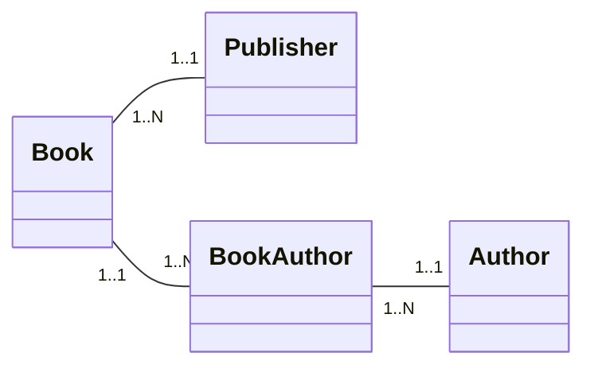
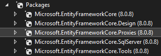

import Laboratoire from '/laboratoire.mdx';

# Chargement Eager/Lazy et CRUD

## Contenu
- Loading (Eager vs Lazy) 
- CRUD dans Controller
   
## Activités de la séance: 
### Théorie:  
- 🔗[Notes de cours](#notes-de-cours) (ci-dessous)
- 🔗[420_3W6_cours_07_Loading.pptx](../assets/cours/presentations/420_3W6_cours_07_Loading.pptx) (présentation originale)

### Laboratoire: 
#### GitHub FORK Laboratoire
- Labo 🔗[S07_Lab1_CRUD](https://github.com/A26ProgWebTrans/S07_Lab1_CRUD)
### Travail personnel: 
- Compléter le Laboratoire

---

## Notes de cours

### Eager vs Lazy Loading
Lorsque l’on obtient des entités de la BD avec une requête Linq, elle retourne uniquement les données de la classe concernée. Elle ne retourne pas les données contenues dans les autres entités auxquelles cette instance est reliée. Les propriétés de navigation sont donc null.

Si, par exemple, on fait une requête pour obtenir un Blog, la propriété de navigation `List<Posts>` est null par défaut.

Il y a 2 grandes stratégies, avec leurs avantages et inconvénients :
- Obtenir plus d’information dans une même requête (**Eager Loading**)
- Attendre d’avoir besoin de l’information avant de faire d’autres requêtes (**Lazy Loading**)

#### Exemple de situation problématique
Avec un simple `ToList()`, le système fait une requête avec les données de la table Zombie, mais pas les données de la table ZombieType! On a donc une propriété de navigation qui n’est pas remplie!

```csharp
zombies = _dbContext.Zombie.ToList();

foreach(var z in zombies)
{
    // On obtient une erreur car ZombieType est null
    // Et on ne peut pas lire la propriété TypeName si ZombieType est null (NullReference Exception!)
    Console.WriteLine(z.ZombieType.TypeName);
}
```

### Eager Loading
Parfait pour afficher le type de chaque zombie dans une liste qui affiche l’info de tous nos zombies!

```csharp
// En ajoutant un Include, la requête faite au serveur va retourner l'information à propos des ZombieType!
zombies = _dbContext.Zombie.Include(z => z.ZombieType).ToList();

foreach(var z in zombies)
{
    // Il n'y a plus d'erreur car ZombieType est de type ZombieType et non pas ZombieType?
    // Il y a donc NÉCESSAIREMENT un ZombieType d'associé
    Console.WriteLine(z.ZombieType.TypeName);
}
```

#### Eager Loading (avancé)
Si on a besoin d’accéder à l’information de plusieurs propriétés de navigation, il faut faire tous les `Include` nécessaires! Et quand on va chercher à un niveau plus loin, on utilise `ThenInclude`!



```csharp
// Ici, on obtient non seulement l'information de la table Books, mais également celle de BookAuthor, Author et Publisher
// Et ces 3 propriétés de navigation contiennent les données pour toutes les entrées retournées!
_dbContext.Books
    // C'est pratique de mettre les ThenInclude sur la même ligne!
    .Include(b => b.BookAuthors).ThenInclude(ba => ba.Author)
    .Include(b => b.Publisher)
    .ToList();
```

### Lazy Loading
Ce qu’il faut faire pour l’utiliser :

1. Ajouter la dépendance `Microsoft.EntityFrameworkCore.Proxies` (même version que les autres packages).

   

2. Activer l’option `UseLazyLoadingProxies()` dans le DbContext :

   ```csharp title="Program.cs"
   builder.Services.AddDbContext<ZombiePartyDbContext>(options =>
       options.UseSqlServer(builder.Configuration.GetConnectionString("DefaultConnection")).UseLazyLoadingProxies()
   );
   ```

3. Rendre TOUTES les propriétés de navigation `virtual` :

   ```csharp
   [ValidateNever]
   public virtual ZombieType ZombieType { get; set; }
   ```

C’est une technique idéale pour afficher l’information d’un seul zombie ou pour afficher le type seulement dans une situation particulière.

```csharp
// On peut faire la requête sans Include avec le Lazy Loading
zombies = _dbContext.Zombie.ToList();

foreach(var z in zombies)
{
    Console.WriteLine(z.Name);
    // Quand un zombie est vraiment fort, on va lire la propriété ZombieType
    if (z.Force > 1000)
        // À chaque fois, le système doit faire une requête pour obtenir le ZombieType!
        Console.WriteLine("Super strong: " + z.ZombieType.TypeName);
}
```

### Quand utiliser chaque stratégie?
- Être **Eager**, c’est bien quand on veut lire les données dans la propriété de navigation chaque fois. Particulièrement s’il y en a beaucoup.
- Être **Lazy**, c’est bien quand on veut lire peu de fois dans la propriété de navigation ou si nous ne sommes pas certains si une propriété sera lue ou non. C’est également une bonne option quand on est nous-mêmes paresseux… Pas besoin d’écrire `.Include()` partout! Donc, pour les `.Single`, `.First` et autres requêtes qui retournent peu d’entrées, ça peut être une bonne option!

#### Pourquoi pas hybride?
Ce n’est pas nécessaire de faire un seul choix!

Si vous avez configuré votre application pour utiliser le Lazy Loading, c’est encore possible d’utiliser `.Include()` dans vos requêtes pour obtenir l’information plus efficacement lorsque vous savez que vous allez devoir lire la propriété de navigation. Surtout si c’est pour de nombreuses entités!

### Comment passer des paramètres à une méthode POST
On veut parfois passer autre chose qu’un modèle à la méthode POST. Dans ce cas, on peut ajouter des paramètres à notre formulaire. On utilise cette technique lorsqu’on fait un Delete, par exemple.

```cshtml
<form asp-action="DeletePost" asp-route-Id="@Model.Id">
```

L’id est passé à la méthode du contrôleur :

```csharp
[HttpPost]
[ValidateAntiForgeryToken]
public async Task<IActionResult> DeletePost(int id)
{
    Zombie? zombie = await _baseDonnees.Zombies.FindAsync(id);
    if (zombie == null)
    {
        return NotFound();
    }
    // ...
}
```

:::note
On peut mettre `asp-route-id` ou `asp-route-Id`, mais on ne met pas de majuscule côté C#.
:::

### Démo Lazy Loading
Comment fonctionnent les proxies lorsque l’on active le Lazy Loading?
