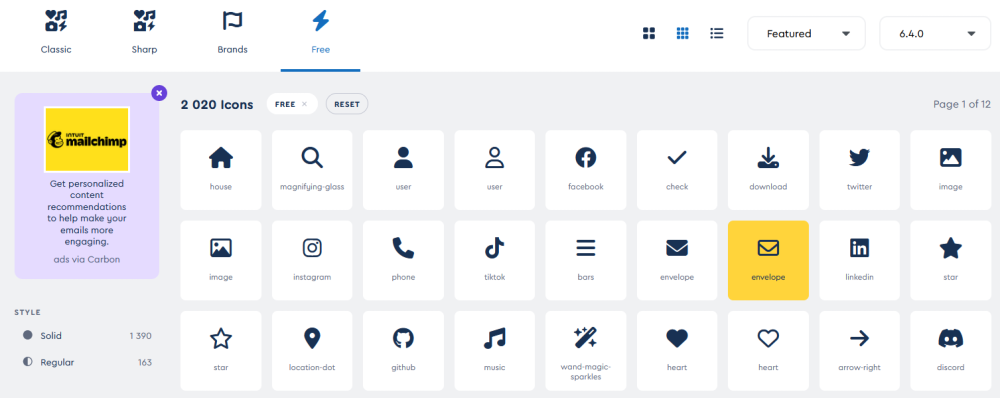
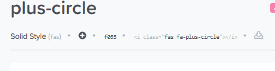

import Laboratoire from '/laboratoire.mdx';

# Méthodes asynchrones et génération de vues

## Contenu
- Méthodes asynchrones
- FontAwesome
- Accordéon
- Lambda avec champ ?
- Génération de vues et contrôleurs

## Ressources et documentation: 
- [FontAwesome](https://fontawesome.com/)

## Activités de la séance: 
### Théorie:  
- 🔗[Notes de cours](#notes-de-cours) (ci-dessous)
- 🔗[420_3W6_cours_10_Async.pptx](../assets/cours/presentations/420_3W6_cours_10_Async.pptx) (présentation originale)

### Laboratoires: 
#### GitHub FORK Laboratoire
- Labo 1 : 🔗[ S10_AsyncAndThirdParty](https://github.com/A26ProgWebTrans/S10_Lab1_AsyncAndThirdParty)
- Labo 2 : 🔗[ S10_enerateController](https://github.com/A26ProgWebTrans/S10_Lab2_GenerateController)


### Travail personnel: 
- Compléter le laboratoire
Travail sur le [TP2](/tp/tp2)

---

## Notes de cours

### Contenu du cours
- [Pourquoi utiliser l’asynchrone](#pourquoi-utiliser-lasynchrone)
- [La trinité](#la-trinité-de-lasync)
- [Exemple Sync vs Async](#comparaison-sync-et-async-exemple-console)
- [Async avec Entity Framework](#utilisation-dans-un-contrôleur)
- [Lambda et ?](#utilisation-de--avec-un-lambda)
- [Bind](#génération-de-contrôleurs-et-bind)
- [Font Awesome](#font-awesome)

### Pourquoi utiliser l’asynchrone
Sans asynchrone, le processeur est bloqué à ne rien faire lorsqu’il attend une réponse. Ça peut arriver dans de nombreux cas :
- Requête de BD
- Requête réseau
- Création d’un fichier
- Etc.

En utilisant un appel asynchrone, on peut libérer notre processeur pour qu’il fasse une autre tâche pendant ce délai. Le processeur pourrait par exemple commencer à traiter la requête pour une page qui vient d’un autre client.

### La trinité de l’async
Il y a 3 éléments qui doivent travailler ensemble pour pouvoir faire un appel de fonction asynchrone.

| Mots clés | Description |
|---|---|
| `Task` et `Task<T>` | Objets utilisés en arrière-plan |
| `async` | Indicateur de méthode asynchrone |
| `await` | Mot clé transférant le contrôle de la méthode d’appel à la méthode appelante jusqu’à la fin de l’exécution de l’instruction (tâche) en attente |

### Comparaison sync et async (exemple console)

```csharp title="Sync"
char LongCalculation()
{
    Thread.Sleep(2000);
    return 'X';
}

public void Action()
{
    char c = LongCalculation();
    Console.WriteLine(Console.ReadKey(true).KeyChar);
    Console.WriteLine(c);
}
```

Impossible d’appuyer sur une touche avant la fin des 2 secondes, car le processeur est resté bloqué à l’appel à `Thread.Sleep`.

```csharp title="Async"
async Task<char> LongCalculationAsync()
{
    await Task.Delay(2000);
    return 'X';
}

public async Task Action()
{
    Task<char> task = LongCalculationAsync();
    Console.WriteLine(Console.ReadKey(true).KeyChar);
    Console.WriteLine(await task);
}
```

En utilisant la méthode asynchrone, la fonction `LongCalculationAsync` retourne dès que le `await` est utilisé, mais la méthode retourne une `Task`, pas un `char`. On peut tout de suite entrer une touche et l’afficher, et on attend ensuite que les 2 secondes soient terminées, car on attend maintenant le résultat avec `await`.

#### Appel sync, étape par étape
1. **Action** : appel de `LongCalculation()`.
2. **LongCalculation** : on attend 2 secondes. Saisir une touche ne fait rien, car `Console.ReadKey` n’a pas encore été appelé.
3. **Retour de la fonction** : après 2 secondes, la fonction retourne.
4. **Console.ReadKey** : on appelle `Console.ReadKey` et on attend que l’utilisateur saisisse une touche.
5. **L’utilisateur appuie sur une touche** : la console affiche cette dernière, puis affiche le char `c`, donc `X`.

:::note Résumé sync
Ce qu’il faut retenir de l’exemple sync, c’est qu’en utilisant `Thread.Sleep(2000)`, on bloque complètement notre logique et on ne peut plus interagir avec l’application!
:::

#### Appel async, étape par étape
1. **Action** : appel de `LongCalculationAsync()`.
2. **LongCalculationAsync** : appel de `Task.Delay(2000);` et `await` retourne immédiatement une `Task` à la méthode `Action`.
3. **Console.ReadKey** : on appelle `Console.ReadKey` et on attend que l’utilisateur saisisse une touche.
4. **L’utilisateur appuie sur une touche** : la console affiche cette dernière. `await task` attend le résultat de la tâche sans bloquer le processeur.
5. **Lorsque le délai de 2 secondes est terminé** : la console affiche `X`, le résultat de la tâche.

### Comment utiliser async
- Les méthodes qui utilisent des fonctions async doivent ajouter un `await` pour lire le résultat.
- Une méthode avec un `await` doit être identifiée comme `async` et retourner `Task<>`. Si on retourne `void`, on écrit simplement `Task`.

```csharp
void FonctionSansRetour()
// devient
async Task FonctionSansRetourAsync()

// Et une fonction qui retourne un char retourne maintenant un Task<char>
async Task<char> LongCalculationAsync()
```

#### Utilisation dans un contrôleur
```csharp title="Version sync"
public class BookController : Controller
{
    public IActionResult Index()
    {
        List<Book> list = _db.Book.ToList();
        return View(list);
    }
}
```

```csharp title="Version async"
public class BookController : Controller
{
    public async Task<IActionResult> Index()
    {
        List<Book> list = await _db.Book.ToListAsync();
        return View(list);
    }
}
```

#### Exemple avec SaveChangesAsync
```csharp title="Version sync"
//POST CREATE
[HttpPost]
public IActionResult Create(BookVM bookVM)
{
    if (ModelState.IsValid)
    {
        _db.Book.Add(bookVM.Book);
        _db.SaveChanges();
        // …
```

```csharp title="Version async"
//POST CREATE
[HttpPost]
public async Task<IActionResult> Create(BookVM bookVM)
{
    if (ModelState.IsValid)
    {
        await _db.Book.AddAsync(bookVM.Book);
        await _db.SaveChangesAsync();
        // …
```

#### Async en contexte web
- Les différentes requêtes sont effectuées sur différentes instances de nos contrôleurs.
- En utilisant async, on permet à un plus grand nombre de contrôleurs de travailler efficacement pour répondre aux requêtes.

### Utilisation de ? avec un lambda
Si une propriété est optionnelle, on la marque avec un `?`. Par exemple :

```csharp
public int? Force { get; set; }
```

Quand c’est le cas, `Force` peut maintenant être null et, si je veux la valeur de la propriété, je dois faire `Force.Value`.

Si j’écris un lambda dans un Linq pour trouver la valeur maximale, je ne peux PAS faire ceci, car `Max` fonctionne avec des `int`, mais pas avec des `int?` :

```csharp
Zombies.Max(z => z.Force);
```

Mais je peux faire :

```csharp
Zombies.Max(z => z.Force != null ? z.Force.Value : 0);
```

Car mon lambda retourne maintenant un `int` (la `Value` si ce n’est pas null, sinon 0).

### Génération de contrôleurs et [Bind]
- Lorsque l’on génère un contrôleur, il contient des instructions `[Bind]` par défaut dans les méthodes POST (Create et Edit).
- L’instruction `[Bind]` permet de spécifier comment les champs du formulaire sont reliés à notre modèle.
- Mais comme le comportement par défaut est suffisant, c’est préférable de les enlever.
- Comme ça, vous ne risquez pas d’ajouter un champ dans votre objet et d’oublier de mettre à jour le bind!

```csharp title="Code généré"
[HttpPost]
[ValidateAntiForgeryToken]
public async Task<IActionResult> Create([Bind("Id,Name")] MonTest monTest)
{
    if (ModelState.IsValid)
    {
        _context.Add(monTest);
        await _context.SaveChangesAsync();
        return RedirectToAction(nameof(Index));
    }
    return View(monTest);
}
```

```csharp title="Sans [Bind]"
[HttpPost]
[ValidateAntiForgeryToken]
public async Task<IActionResult> Create(MonTest monTest)
{
    if (ModelState.IsValid)
    {
        _context.Add(monTest);
        await _context.SaveChangesAsync();
        return RedirectToAction(nameof(Index));
    }
    return View(monTest);
}
```

### Font Awesome
- [https://fontawesome.com/search?o=r&m=free](https://fontawesome.com/search?o=r&m=free)



#### Utilisation de Font Awesome
1. Téléchargez la librairie : [https://fontawesome.com/download](https://fontawesome.com/download)
2. Ajoutez la référence dans le `_Layout`.
3. Copiez le HTML de l’icône et ajoutez-le dans la vue.



```cshtml
<a asp-controller="Home" asp-action="Create" class="btn btn-info">
    <i class="fas fa-plus"></i> &nbsp; Create New Travel</a>
```


