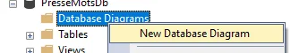
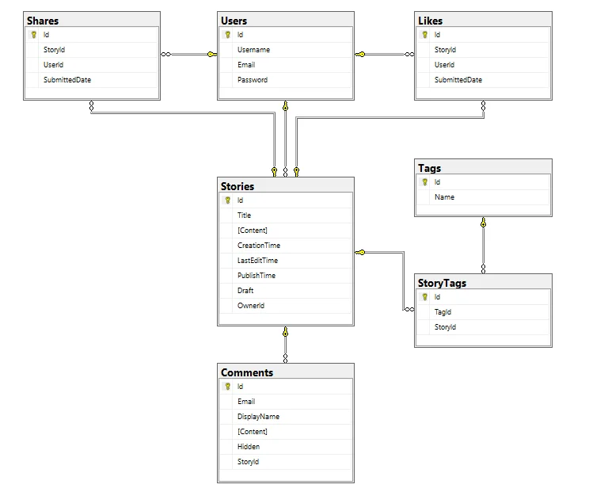
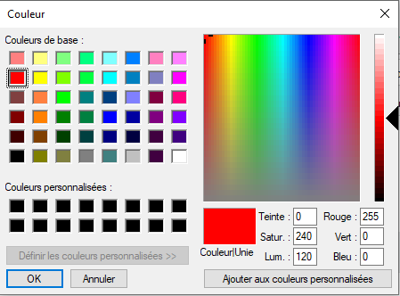
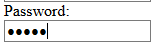
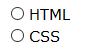
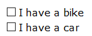
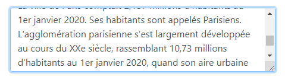

import Laboratoire from '/laboratoire.mdx';

# Diagrammes BD et laboratoire de révision

## Contenu
- Présentation de Database Diagrams dans SQL Server Management Studio

| |
| --- |
|  |
<details>

</details>


- Présentation du laboratoire de révision
- Explication d'un contrôleur et de ses vues générées
- Révision

## Ressources et documentation: 
- [W3Schools_Input_Types](https://www.w3schools.com/html/html_form_input_types.asp)

## Activités de la séance

### Théorie:  
- 🔗[Notes de cours](#notes-de-cours) (ci-dessous)
- 🔗[420_3W6_cours_11_Revision.pptx](../assets/cours/presentations/420_3W6_cours_11_Revision.pptx) (présentation originale)

### Laboratoire
#### GitHub FORK Laboratoire
- Labo 🔗[S11_Revision](https://github.com/A26ProgWebTrans/S11_Revision)


### Travail personnel: 
- Terminer le laboratoire de révision
- Travail sur le [TP2](/tp/tp2)

### Révision

<details>
#### Views et PartialViews

```csharp title="Contôleur Zombie"
public IActionResult UneAction()
{
    Zombie z = new Zombie(){
        Name = "Nom du zombie"
    };

    // Par défaut, la vue qui est construite porte le nom de l'action et se trouve dans le répertoire qui a le nom du contrôleur
    return new View(z);
    // Il est possible de retourner une vue par son nom
    // return new View("AutreNom", z);
}
```

Le modèle d'une vue c'est l'équivalent du paramètre d'une fonction et il est passé dans le contrôleur

```ts title="Vue avec modèle"
@model Zombie

<span>@Model.Name</span>
```

OU

```ts title="Vue avec modèle et HtmlHelper"
@model Zombie

<span>@Html.DisplayFor(model => model.Name)</span>
```


Génère simplement le html

```html
<span>Puant</span>
```

Une vue partielle peut également avoir son propre modèle et on peut fournir la valeur avec le paramètre model

```html title="Vue partielle"
<partial name="_NomDeLaVue" model="valeur"/>
```

#### ViewModels

On nomme ViewModels une classe que l'on utilise spécifiquement pour afficher une vue.

Elle contient généralement:
- D'autres données
    - Des statistiques
    - Des listes pour faire des sélections
- L'état de la page
    - La valeur courante d'un champ de recherche
    - La pagination lorsque l'on veut voir une grande quantité de données
    - D'autres options


#### TagHelper et asp-for 

Le mot "For" utilisé dans les fonctions suivantes fait référence aux propriétés du modèle fourni:

```ts
@model X
```

Regardez le html généré par les choses suivantes:

```ts
@Html.DisplayNameFor(model => model.Name)
@Html.DisplayFor(model => model.Name)
```

```ts
asp-for="Name"
asp-validation-for="Name"
```

#### EntityFramework (EF)

- Propriétés de navigation
- Relations
    - 1 à N
    - N à N
    - 1 à 1

#### Annotations

Exemples:

```csharp
[StringLength(100, MinimumLength = 20)]

[Range(10,35)]

[Required(ErrorMessage = "EmailRequired")]
```

Révision du ?

Pour les propriétés de navigation avec une clé étrangère, il doit être sur les deux ou pas du tout

```csharp title="Relation obligatoire"
public class Joueur
{
    public int Id {get; set;}

    // Relation obligatoire 1..1
    public int EquipeId {get; set;}
    public Equipe Equipe {get; set;}
}
```

```csharp title="Relation optionnelle"
public class Joueur
{
    public int Id {get; set;}

    // Relation optionnelle 0..1
    public int? EquipeId {get; set;}
    public Equipe? Equipe {get; set;}
}
```


#### Validations

ModelState.IsValid

Comprendre le retour de View vs RedirectToAction!

Comprendre la validation client VS serveur VS BD

#### Asynchrone

Comment transformer une méthode pour qu'elle soit asynchrone et puisse utiliser des méthodes asynchrones

3 choses:
- Rendre la méthode async
- Changer le type de retour pour une Task&lt;X&gt; où X est le type qui était retourné (ou Task pour un `void`)
- Ajouter un await devant les appels à des méthodes asynchrones comme ToListAsync()


</details>

---

## Notes de cours

### Contenu du cours
- [Révision TagHelpers et types](#tag-helpers)
- [Input type](#les-input-types-input-typexxx)
- [Balises](#balises)

### Tag helpers
| Built-in Tag Helper | Utilisation |
|---|---|
| `asp-for="propertyName"` | Extrait la propriété du modèle (ex. label ou input) |
| `asp-controller="Order"` | Identifie le contrôleur associé à l’élément |
| `asp-action="Upsert"` | Identifie l’action associée à l’élément |
| `asp-validation-summary="ModelOnly"`<br/>`asp-validation-summary="All"`<br/>`asp-validation-summary="None"` | Section qui affiche les messages de validation liés :<br/>- au modèle de données<br/>- au modèle de données et aux propriétés<br/>- aucun |
| `asp-validation-for="Name"` | Généralement utilisé dans un `span` pour présenter le message d’erreur lié à un élément du formulaire (input) |
| `<partial name="_EditAndBackToListButton" model="Model.Id" />` | Identifie la vue partielle<br/>Identifie le modèle passé à la vue partielle |
| `asp-route-cartId="@item.Id"` | Identifie le paramètre passé au contrôleur (attention, le nom du paramètre du contrôleur doit correspondre : `(int cartId)` ici) |

### Les input types `<input type="xxx"/>`
| Input Type | Utilisation | Aperçu |
|---|---|---|
| `color` | Sélecteur de couleur (varie selon le navigateur) |  |
| `date` | Affiche un calendrier pour sélectionner une date, valide le format de la date | |
| `email` | Valide le format `text@text.text` | |
| `password` | TextBox qui affiche un symbole pour chaque caractère saisi |  |
| `radio` | Un seul choix |  |
| `checkbox` | Aucun ou plusieurs choix |  |

### Balises
| Type | Utilisation | Aperçu |
|---|---|---|
| `` | Image, l’attribut `src` contient la source de données | |
| `<textarea></textarea>` | Champ extensible qui permet d’écrire plusieurs lignes de texte |  |

```cshtml
@if (Model.TravelImage != null)
{
    
}
else
{
    
}
```
