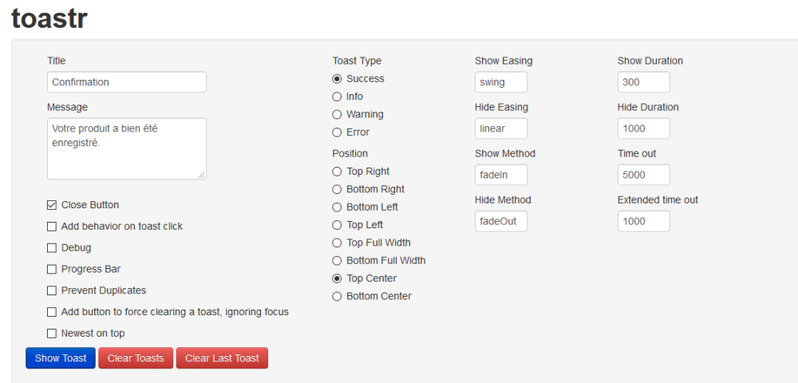
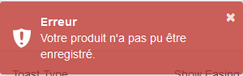
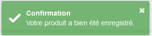
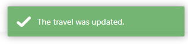

import Laboratoire from '/laboratoire.mdx';

# Retour sur l'intra, images et Toastr

## Contenu

- Retour sur l'examen
- Gestion d'images
- Librairies JS
  - Toastr

## Ressources et documentation: 
- [Toastr (Notifications)](https://codeseven.github.io/toastr/) 
- [MSDN UploadFiles](https://docs.microsoft.com/en-us/aspnet/core/mvc/models/file-uploads?view=aspnetcore-5.0) 
- [W3School_enctype_multipart/form-data](https://www.w3schools.com/tags/att_form_enctype.asp)

#### Complémentaire: 
- [SweetAlert2(Notifications)](https://sweetalert2.github.io/)

## Activités de la séance: 

### Théorie:  
- 🔗[Notes de cours](#notes-de-cours) (ci-dessous)
- 🔗[420_3W6_cours_15_UploadImages_Toastr.pptx](../assets/cours/presentations/420_3W6_cours_15_UploadImages_Toastr.pptx) (présentation originale)

### Laboratoire: 
#### GitHub FORK Laboratoire
- Labo 🔗[S15_Lab1_Images_Toaster](https://github.com/A26ProgWebTrans/S15_Lab1_Upload)


### Travail personnel:
- Compléter le laboratoire

---

## Notes de cours

### Contenu du cours
- [View Models](#view-models)
- [Upload d’images](#pour-téléverser-uploader-une-image)
- [Toastr](#librairie-toastr)

### View Models
Pour aller plus loin que les vues simples.
- En utilisant un ViewModel, on peut inclure d’autres informations que celles qui sont contenues dans notre base de données.
- Par exemple, des champs de recherche ou de l’information à propos des éléments qui sont ouverts ou fermés.

```csharp
public class UserProfileVM
{
    public string searchTerm { get; set; }
    public string usernameEmail { get; set; }

    public bool AuthoredOpened { get; set; }
    public bool LikedStoriesOpened { get; set; }
    public bool SharedStoriesOpened { get; set; }
    public bool LikeableStoriesOpened { get; set; }

    public List<UserProfileStoryVM> AuthoredStories { get; set; }
    public List<UserProfileStoryVM> LikedStories { get; set; }
    public List<UserProfileStoryVM> SharedStories { get; set; }
    public List<UserProfileStoryVM> LikeableStories { get; set; }
}
```

#### Des View Models pour des besoins spécifiques
Pour créer un nouvel utilisateur ou pour changer son mot de passe, on ne veut pas faire une vue qui utilise directement le `User` :
- Premièrement, pour nous permettre d’ajouter des champs qui n’existent pas dans la classe `User`, comme `ConfirmPassword` et `OldPassword`.
- Mais aussi pour simplifier le modèle utilisé par la vue.

```csharp title="User.cs (modèle)"
public class User
{
    public User()
    {
        Stories = new List<Story>();
        Likes = new List<Like>();
        Shares = new List<Share>();
    }
    public int Id { get; set; }
    public string Username { get; set; }
    public string Email { get; set; }
    public string? Password { get; set; }

    public virtual List<Story> Stories { get; set; }
    public virtual List<Like> Likes { get; set; }
    public virtual List<Share> Shares { get; set; }
}
```

```csharp title="NewUserPasswordVM.cs"
public class NewUserPasswordVM
{
    public string Username { get; set; }
    public string Email { get; set; }

    public string Password { get; set; }
    public string ConfirmPassword { get; set; }
}
```

```csharp title="ChangeUserPasswordVM.cs"
public class ChangeUserPasswordVM
{
    public string Username { get; set; }
    public string Email { get; set; }

    public string OldPassword { get; set; }
    public string NewPassword { get; set; }
    public string ConfirmPassword { get; set; }
}
```

### Pour téléverser (uploader) une image
Il faut connaître l’endroit sur le disque où l’on va sauvegarder notre image. On veut donc commencer par obtenir un `IWebHostEnvironment`, qui nous permet d’obtenir cette information. On peut l’injecter dans notre contrôleur de cette façon :

```csharp
private readonly CrazyBooksDbContext _db;
private readonly IWebHostEnvironment _webHostEnvironment;

public HomeController(CrazyBooksDbContext crazyBooksDbContext, IWebHostEnvironment webHostEnvironment)
{
    _db = crazyBooksDbContext;
    _webHostEnvironment = webHostEnvironment;
}
```

#### Exemple d’action pour sauvegarder un fichier
```csharp
//POST CREATE
//Permet de créer une nouvelle entrée pour travel avec une image associée
[HttpPost]
public async Task<IActionResult> Create(Travel travel)
{
    if (ModelState.IsValid)
    {
        string webRootPath = _webHostEnvironment.WebRootPath; //La racine de notre serveur.
        var files = HttpContext.Request.Form.Files; //nouvelle image récupérée
        if (files.Count > 0)
        {
            string fileName = Guid.NewGuid().ToString(); // Nom fichier généré, unique (on évite les Path Traversal)
            var uploads = Path.Combine(webRootPath, AppConstants.ImagePath); // chemin pour les images
            var extension = Path.GetExtension(files[0].FileName); // extraire l'extension du fichier
            // Créer un canal pour transférer le fichier
            using (var filesStreams = new FileStream(Path.Combine(uploads, fileName + extension), FileMode.Create))
            {
                files[0].CopyTo(filesStreams);
            }
            // Composer le nom du fichier avec son extension qui sera enregistré dans la BD
            // avec le path relatif à partir du Root
            // ou sans le path relatif (le path devra être ajouté dans la View)
            travel.TravelImage = fileName + extension;
        }
        // Ajouter à la BD
        await _context.Travel.AddAsync(travel);
        await _context.SaveChangesAsync();
        return RedirectToAction(nameof(Index));
    }
    return this.View(travel);
}
```

#### L’attribut enctype de la balise HTML `<form>`
Permet de choisir de quelle façon les données sont encodées dans le formulaire envoyé au serveur.

| Valeur | Description |
|---|---|
| `application/x-www-form-urlencoded` | Valeur par défaut, tous les caractères sont encodés, les symboles spéciaux sont convertis |
| `multipart/form-data` | **Obligatoire pour le téléchargement de fichiers** |
| `text/plain` | Données sans encodage, déconseillé |

#### Vue Create pour l’upload d’image
- Le formulaire doit utiliser un `enctype="multipart/form-data"`.
- On utilise un input de `type="file"` pour nous permettre de sélectionner un fichier à téléverser.

```cshtml
<form class="form-horizontal" method="post" enctype="multipart/form-data" asp-action="Create">
    …
    <div class="col-8">
        <input type="file" name="files" id="uploadBox" asp-for="TravelImage" class="form-control" />
        <span asp-validation-for="TravelImage" class="text-danger"></span>
    </div>
    …
</form>
```

### Librairie toastr





#### Ajout de la librairie toastr
Ajouter la référence dans le `_Layout` :

```cshtml title="_Layout.cshtml"
<head>
    …
    <link href="https://cdn.jsdelivr.net/npm/summernote@0.8.18/dist/summernote.min.css" rel="stylesheet">
    <link rel="stylesheet"
          href="https://cdnjs.cloudflare.com/ajax/libs/toastr.js/latest/css/toastr.min.css"
          crossorigin="anonymous" />
    <link rel="stylesheet" href="~/css/site.css" />
</head>
…
</footer>
<script src="~/lib/jquery/dist/jquery.min.js"></script>
<script src="~/lib/bootstrap/dist/js/bootstrap.bundle.min.js"></script>
<script src="~/js/site.js" asp-append-version="true"></script>
<script src="https://cdn.jsdelivr.net/npm/summernote@0.8.18/dist/summernote.min.js"></script>
<script src="https://cdnjs.cloudflare.com/ajax/libs/toastr.js/latest/js/toastr.min.js"></script>
```

#### Affichage des notifications toastr
On utilise généralement le `TempData` pour afficher les messages d’erreur.

```cshtml
@using ChampsSpeciaux.Utility
@if (TempData[AppContants.Success] != null)
{
    <script type="text/javascript">
        toastr.success('@TempData[AppContants.Success]');
    </script>
}
@if (TempData[AppContants.Error] != null)
{
    <script type="text/javascript">
        toastr.error('@TempData[AppContants.Error]');
    </script>
}
```

#### Utilisation dans le contrôleur
```csharp
_context.Travel.Update(travel);
_context.Save();
TempData[AppContants.Success] = "The travel was updated.";
return RedirectToAction(nameof(Index));
```


