import Laboratoire from '/laboratoire.mdx';

# Injection de dépendances

## Contenu

- Dependency Injection

## Activités de la séance: 

### Théorie:  
- 🔗[420_3W6_cours_16_Injection_Dépendances.pptx](../assets/cours/presentations/420_3W6_cours_16_Injection_Dépendances.pptx)

### Laboratoire
#### GitHub FORK Laboratoire
- Labo 🔗[S16_Lab1_DependencyInjection](https://github.com/A26ProgWebTrans/S16_Lab1_DependencyInjection)

### Travail personnel:
- Compléter le laboratoire 

## Étapes pour extraire de la logique d'un contrôleur et la mettre dans un service 

- Cette section présente les étapes permettant **de créer un service en retirant de la logique qui se répète dans un ou plusieurs contrôleurs**.

### Étape 1. Cibler le code à extraire

- Nous allons retirer des actions du contrôleur Zombie la création des SelectLists de ZombieType, **parce qu'elle se répète à plusieurs endroits**. 

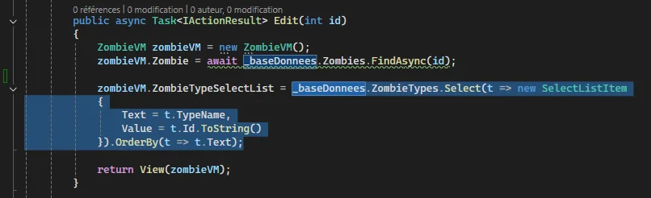
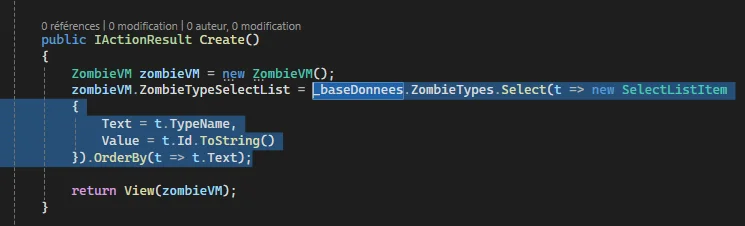

 ---

### Étape 2. Créer le service 

- **Ajoutez une nouvelle classe** dans votre répertoire Utility pour votre service.

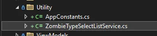

### Étape 3. Ajouter le code nécessaire dans le service.
-  Puisque nous avons besoin du context pour obtenir les zombieTypes, **il faut injecter le dbContext dans notre service**. 

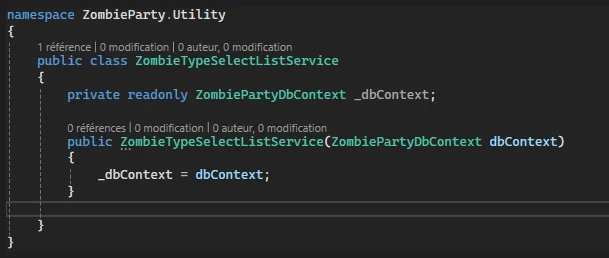

- **Ajoutez la méthode** qui contiendra le code que nous voulons **extraire du contrôleur** puis **ajoutez-y votre code**.
- Ici, **nous avons copié le code qui était dans le contôleur** dans une méthode GetZombieTypes() et nous retournons directement le résultat.
- Notez que **le nom de la variable pour le context est différent dans notre service**. C'est simplement par choix, nous aurions pu aussi le nommer _baseDonnees dans le service. Cela dit, il faut évidemment changer son nom dans le code du service. **Nous avons donc remplacé _baseDonnees par _dbContext**. 
- Assurez-vous de **retourner le bon type de données dans la signature de la méthode**.

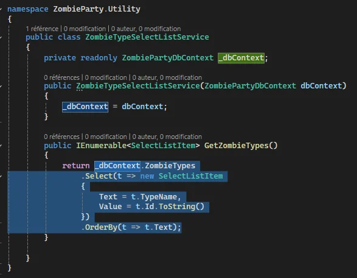

---

### Étape 4. Extraire l'interface 

- Faites un **clic droit sur le nom de la classe** puis dans **Actions rapides et factorisations** cliquez sur **Extraire l'interface**. 

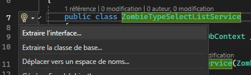

- Cliquez sur **OK** pour créer l'interface. 

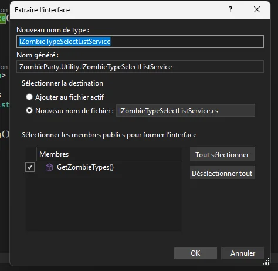

### Étape 5. Ajouter le service dans Program.cs

- Ajoutez le service dans Program.cs **avant le bulder.Build();**
- Notez que nous avons **ajouté un service scoped**. Puisque notre service **se fait injecter le dbContext qui est un service scoped**, nous créons un service qui a **la même durée de vie**. 

 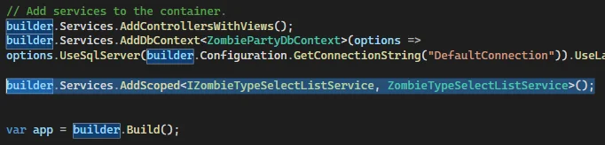

 ---

### Étape 6. Injecter votre nouveau service dans le ou les contrôleurs qui utilisait cette logique de code

 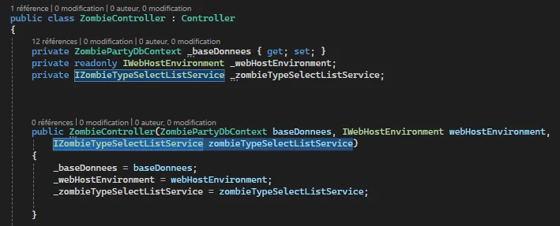

### Étape 7. Utiliser le service dans les actions concernées

- Le code extrait a été mis en commentaire pour l'exemple. Maintenant nous **appelons la méthode GetZombieTypes() de notre service** pour remplir **zombieVM.ZombieTypeSelectList**.

 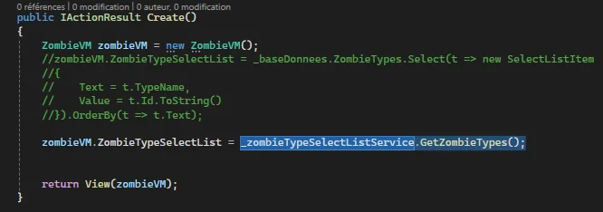

 ### Étape 8. Valider que le résultat est identique.

  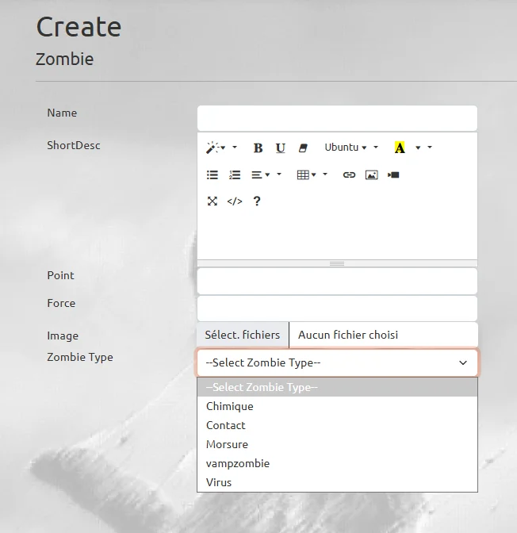