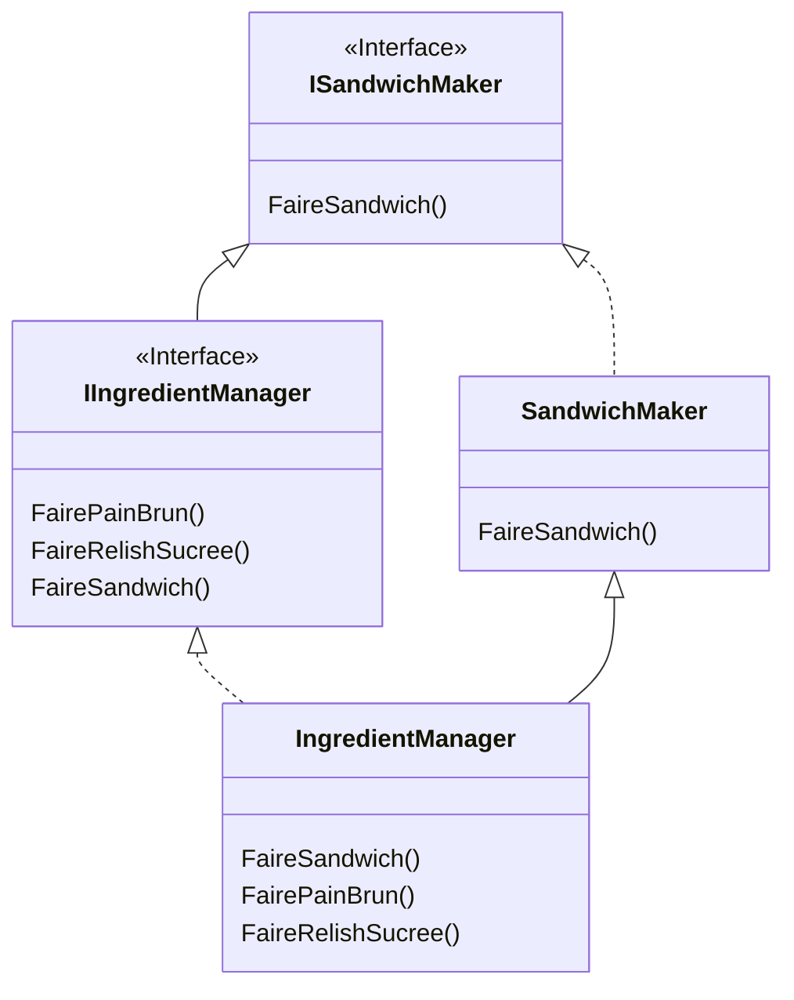
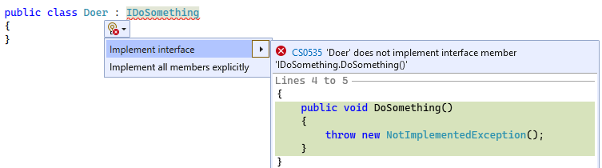

import Laboratoire from '/laboratoire.mdx';

# Services et génériques

## Contenu

- Dependency Injection (suite)
- Service dans les controllers
- Generics

## Activités de la séance: 

### Théorie:  
- 🔗[Notes de cours](#notes-de-cours) (ci-dessous)
- 🔗[420_3W6_cours_17_Generics_Services.pptx](../assets/cours/presentations/420_3W6_cours_17_Generics_Services.pptx) (présentation originale)

### Laboratoire
#### GitHub FORK Laboratoire
- Labo 🔗[S17_Lab1_Generic_Services](https://github.com/A26ProgWebTrans/S17_Lab1_Services)


### Travail personnel:
- Compléter le laboratoire

## Notes de cours

### Contenu du cours
- Révision Dependency Injection
- Services
- Generics
- Generics avec interface
- IReadOnlyList
- Un service CRUD generics
- Génération de code d’une interface
- Injecter notre service

### Révision Dependency Injection (DI)
- On peut ajouter une dépendance (ou service) dans `Program.cs`.
- Une dépendance peut avoir une des durées de vie suivantes :
  - `AddSingleton` (une seule instance créée)
  - `AddScoped` (une instance créée pour la durée d’une action d’un contrôleur)
  - `AddTransient` (nouvelle instance créée pour chaque demande; les instances sont détruites à la fin du scope/action)
- Nous avons vu deux manières d’injecter le service :
  - Constructeur
  - `[FromServices]`

Voir les [notes du cours 16](/cours/rencontre8.2#notes-de-cours) pour plus de détails.

### Créer nos propres services
Pourquoi veut-on créer nos propres services?
- Réutiliser notre code
- Bien séparer les responsabilités, car sinon, nos contrôleurs risquent de devenir trop complexes

La tâche du contrôleur, c’est de vérifier les paramètres reçus, de retourner les bons codes d’erreur ou de succès et de rediriger vers la bonne page si nécessaire. C’est déjà beaucoup, alors on veut déplacer le reste de la logique dans un service.

### Generics
On peut utiliser des interfaces pour avoir du code qui traite des objets de classes différentes qui partagent une même interface. Mais le type retourné est alors du type de l’interface. Ça peut mener à beaucoup de « casts ».

```csharp
public class SuperInterfaceManager
{
    public IScore? PartieAvecLePlusPetitScore(IScore a, IScore b)
    {
        int difference = a.GetScore() - b.GetScore();
        if (difference < 0)
            return a;
        if (difference > 0)
            return b;
        return default;
    }

    // Cette méthode est simplement présente pour donner un exemple d'utilisation
    public static void Main()
    {
        Partie partieA = new Partie(3);
        Partie partieB = new Partie(4);

        var sim = new SuperInterfaceManager();

        Partie? partieAvecPlusPetitScore = (Partie?)sim.PartieAvecLePlusPetitScore(partieA, partieB);
    }
}
```

Avec les generics, on peut écrire du code qui traite des objets de classes différentes, mais qui traite ces objets directement dans le type spécifié dans le generic.

L’exemple de generic que vous utilisez tout le temps, c’est `List<T>`. Si on écrit `List<Bateau>`, on a une liste dont les méthodes ont maintenant le type `Bateau`.

Voici un exemple de classe qui gagne à devenir générique :

```csharp title="Sans generics"
public class SandwichMaker3000
{
    public List<object> FaireUnSandwich(object exterieur, object interieur)
    {
        var liste = new List<object>();

        liste.Add(exterieur);
        liste.Add(interieur);
        liste.Add(exterieur);

        return liste;
    }
}
```

```csharp title="Avec generics"
public class SandwichMaker3000<T>
{
    public List<T> FaireUnSandwich(T exterieur, T interieur)
    {
        var liste = new List<T>();

        liste.Add(exterieur);
        liste.Add(interieur);
        liste.Add(exterieur);

        return liste;
    }
}
```

Remarquez que l’on peut passer le type générique `T` de `SandwichMaker3000` à la liste!

#### Démo de generics et interfaces
Présentation en classe.

:::note
On veut parfois limiter comment on interagit avec un objet en retournant une interface qui expose seulement une partie des fonctionnalités. On le voit dans l’utilisation de `IReadOnlyList`.
:::

#### Generics, héritage et interfaces
Implémenter une interface ET hériter d’une classe alors que les deux découlent de la même interface de base! 🤯



### Un service CRUD generics
Dans le laboratoire, nous allons faire un service générique pour gérer les actions CRUD de nos modèles.

### Génération de code d’une interface
- Lorsque l’on hérite d’une interface, on peut utiliser une action rapide pour implémenter les méthodes.
- Toutes les méthodes générées lancent une exception.



### Injecter notre service
N’oubliez pas qu’il faut injecter chacun des services que l’on va utiliser dans notre application.

Voici comment injecter un service avec une interface :
```csharp title="Program.cs"
builder.Services.AddScoped<IDoSomething, Doer>();

var app = builder.Build();
```

Voici comment injecter un service avec une classe générique :
```csharp title="Program.cs"
builder.Services.AddScoped(typeof(SandwichMaker3000<>));

var app = builder.Build();
```

Classe générique avec interface :
```csharp title="Program.cs"
builder.Services.AddScoped(typeof(IServiceBaseAsync<>), typeof(ServiceBaseAsync<>));
```
