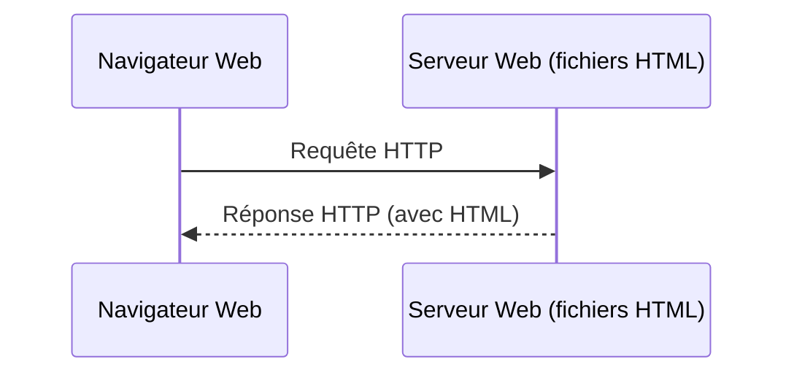
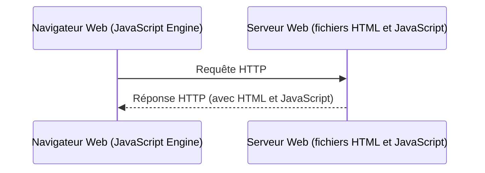
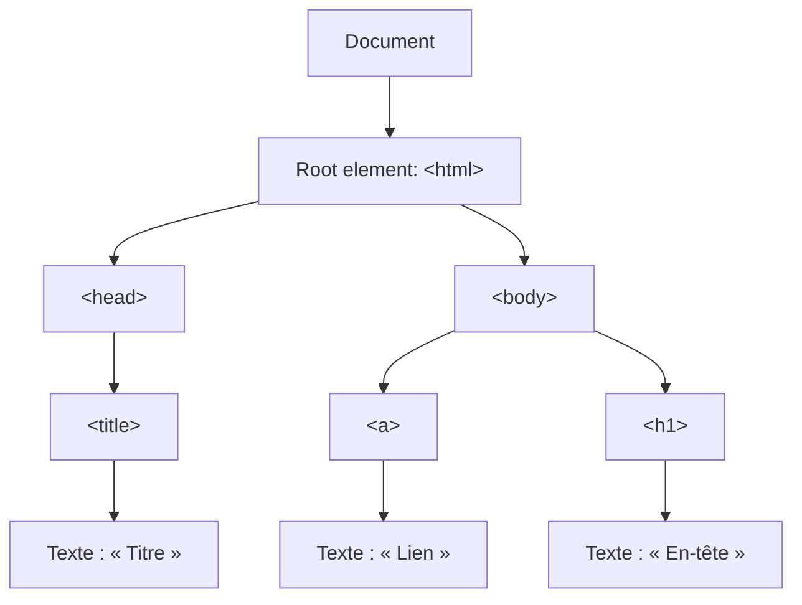

import Laboratoire from '/laboratoire.mdx';

# Introduction à JavaScript

## Contenu
- Introduction à Javascript 

## Ressources et documentation: 
- [Exemples W3Schools HTML](https://www.w3schools.com/js/js_examples.asp) 
- [Exemples W3Schools JS](https://htmlcheatsheet.com/js/) 
- [HTML DOM Style object (w3schools.com)](https://www.w3schools.com/jsref/dom_obj_style.asp) 
- [JQuery](https://api.jquery.com/)
- [jQuery Plugin Registry](https://plugins.jquery.com/)  
- [DataTables.net](https://datatables.net/)
- [VS Hot Reload](https://learn.microsoft.com/fr-ca/visualstudio/debugger/hot-reload?view=vs-2022)

## Activités de la séance: 

### Théorie:  
- 🔗[Notes de cours](#notes-de-cours) (ci-dessous)
- 🔗[420_3W6_cours_18_JavaScript.pptx](../assets/cours/presentations/420_3W6_cours_18_JavaScript.pptx) (présentation originale)

### Laboratoires
#### GitHub FORK Laboratoire 
- Labo 1 🔗[S18_Lab1_Javascript](https://github.com/A26ProgWebTrans/S18_Lab1_JavaScript)
- Labo 2 🔗[S18_Lab2_Javascript](https://github.com/A26ProgWebTrans/S18_Lab2_JavaScript)


### Travail personnel: 
- Compléter les laboratoires

## Notes de cours

### Contenu du cours
- JS, c’est quoi?
- Document Object Model (DOM)
- Comment l’ajouter à une page
- Détails du langage
- API JavaScript
- Infos supplémentaires

### JavaScript, c’est quoi?
Sur le web :
- HTML est utilisé pour structurer le document.
- JavaScript est utilisé pour les interactions. C’est le langage de script qui est supporté par les navigateurs. Il n’y a pas d’autres options, sauf WebAssembly, qui n’a pas encore vraiment percé.
- C’est un langage sans compilation, il est donc interprété, comme du Python par exemple.

Ce cours est basé sur le cours de JavaScript de W3Schools : [https://www.w3schools.com/js/js_examples.asp](https://www.w3schools.com/js/js_examples.asp)

#### Page web statique


#### Page web dynamique avec JavaScript


#### Interaction sur la page
Une fois que le navigateur a obtenu la page avec du JavaScript, c’est ensuite possible d’avoir de l’interactivité avec la page à travers les fonctionnalités offertes en JavaScript, et ce, sans faire d’autres appels au serveur. JavaScript peut :
- [Changer le contenu du HTML](https://www.w3schools.com/js/tryit.asp?filename=tryjs_intro_inner_html)
- [Changer les attributs HTML](https://www.w3schools.com/js/tryit.asp?filename=tryjs_intro_lightbulb)
- [Changer le style CSS](https://www.w3schools.com/js/tryit.asp?filename=tryjs_intro_style)
- [Cacher des éléments](https://www.w3schools.com/js/tryit.asp?filename=tryjs_intro_hide)
- [Afficher les éléments cachés](https://www.w3schools.com/js/tryit.asp?filename=tryjs_intro_show)

:::note
C’est également possible de faire des appels à un serveur avec des fonctions JavaScript pour obtenir ou modifier certaines données. On appelle généralement ces appels des appels AJAX et nous allons les couvrir plus tard dans ce cours.
:::

### Une page est composée d’un DOM
- Le DOM est le **Document Object Model**.
- C’est la façon dont est structurée votre page HTML. JavaScript va l’utiliser pour accéder à des éléments spécifiques.
- JavaScript agit sur ce DOM. Il faut aussi qu’il soit chargé pour y accéder.



### Comment ajoute-t-on un script dans une page?
On utilise la balise `<script>` :

```html
<script>let foo="bar";</script>
<!-- ou -->
<script src="monScript.js"></script>
```

- Il faut aussi que le navigateur supporte le JavaScript.
- Vous pouvez d’ailleurs désactiver l’exécution du JavaScript. Si vous le faites, la plupart des sites web qui demandent de l’interaction ne fonctionneront plus.
- On va privilégier de mettre nos scripts dans des fichiers, sauf dans les cas les plus simples, afin que nos projets soient plus faciles à maintenir.

### Un langage à part entière
Voici donc les bases.

```js title="Les variables"
let a; // variable
let b = "init"; // string
let c = "Hi" + " " + "Joe"; // = "Hi Joe"
let d = 1 + 2 + "3"; // = "33"
let e = [2,3,5,8]; // tableau
let f = false; // boolean
let g = /()/; // RegEx
let h = function(){}; // fonction
const PI = 3.14; // constante
let a = 1, b = 2, c = a + b; // une ligne
let z = 'zzz'; // variable à portée locale
```

```js title="Les valeurs spéciales"
false, true // boolean
18, 3.14, 0b10011, 0xF6, NaN // nombre
"flower", 'John' // string
undefined, null , Infinity // special
```

```js title="Opérateurs"
a = b + c - d; // addition, soustraction
a = b * (c / d); // multiplication, division
x = 100 % 48; // modulo. 100 / 48, reste = 4
a++; b--; // incrément / décrément
```

#### Logique et arithmétique
```js
a * (b + c)         // regroupement
person.age          // membre
person["age"]       // membre
!(a == b)           // non logique
a != b              // différent de
typeof a            // type (number, object, function...)
x << 2  x >> 3      // déplacement binaire
a = b               // assignation
a == b              // égal
a != b              // différent de
a === b             // égal strict (type et contenu)
a !== b             // différent de strict (type et contenu)
a < b   a > b       // plus petit ou plus grand
a <= b  a >= b      // plus petit ou égal, plus grand ou égal
a += b              // a = a + b (fonctionne avec - * %...)
a && b              // et logique
a || b              // ou logique
```

#### Boucles for
```js
for (let i = 0; i < 4; i++){
    console.log(i + ":" + i*2);
}

let sum = 0;
let tableau = [1, 2, 3, 4];
for (let i = 0; i < tableau.length; i++){
    sum += tableau[i];
}
console.log(sum);

let html = "";
let clients = ["Xavier", "David"];
for (let i of clients){
    html += "<li>" + i + "</li>";
}
```

#### Boucle while, break et continue
```js
// Boucle while
let i = 1; // initialisation
while (i < 100){ // tant que c'est vrai on répète le bloc
    i *= 2;
    console.log(i);
}

// Break
for (let i = 0; i < 10; i++){
    if (i == 5){
        break;
    } // si i vaut 5 on arrête et on sort du `for`
    console.log(i);
}

// Continue
for (let i = 0; i < 10; i++){
    if (i == 5){
        continue;
    } // si i vaut 5 on saute l'itération actuelle
    console.log(i);
}
```

#### if…else
```js
if ((age >= 14) && (age < 19)) {
  status = "Eligible.";
}
else {
  status = "Not eligible.";
}
```

### API JS
| Type | Description |
|---|---|
| `document` | Racine du DOM. Peut avoir un seul nœud element comme enfant. |
| `element` | Un élément de la page web. Peut avoir des nœuds element, text et comment comme enfants. |
| `attr` | Attribut d’un élément. Attaché à un nœud element, il n’est pas considéré comme un enfant. |
| `text` | Le texte d’un élément ou d’un attribut. Ne peut pas avoir d’enfant. |

| Méthode | Description |
|---|---|
| `getElementById("id")` | Identifier un élément HTML par l’attribut id, unique dans la page |
| `getElementsByName("name")` | Identifier une collection d’éléments HTML par l’attribut name |
| `getElementsByTagName("tag")` | Identifier une collection d’éléments HTML par leur nom de balise (ex. : "p", "button", "li") |

Pour manipuler les attributs d’un élément :

| Méthode | Description |
|---|---|
| `hasAttribute(nom)` | Retourne vrai si l’élément a l’attribut en paramètre |
| `getAttribute(nom)` | Retourne la valeur de l’attribut en paramètre |
| `setAttribute(nom, valeur)` | Modifie la valeur de l’attribut en paramètre par la valeur en paramètre |
| `removeAttribute(nom)` | Supprime l’attribut passé en paramètre |

Pour obtenir la valeur d’un élément ou obtenir les éléments reliés :

| Propriétés | Description |
|---|---|
| `nodeValue` | Retourne le texte du nœud (Text, Comment) ou null pour un élément (comme `<div>` ou `<p>`) |
| `parentNode` | Retourne le nœud parent s’il existe ou null |
| `childNodes` | Retourne un array d’objets qui représente les enfants du nœud courant |
| `firstChild` | Retourne le nœud de l’objet du 1er enfant ou null |
| `lastChild` | Retourne le nœud de l’objet du dernier enfant ou null |
| `nextElementSibling` | Retourne le nœud d’objet pour le prochain frère ou null |

Pour en savoir plus : [https://www.w3schools.com/js/default.asp](https://www.w3schools.com/js/default.asp)

### Langage au typage dynamique
En JS, on peut simplement assigner des valeurs à un objet, qui stocke ses propriétés comme un dictionnaire.

```js
let moto = {};
moto.cie = 'Yamaha';
moto.dateAchat = new Date(2005,3,12);
```

:::warning Erreur fréquente
Vous voulez changer la date d’achat de votre moto, qui possède une valeur `dateAchat`. Au lieu de :

```js
moto.dateAchat = new Date(2005,2,11);
```

Vous tapez :

```js
moto.dateachat = new Date(2005,2,11);
```

Vous venez de créer une nouvelle propriété. Vous n’obtiendrez pas de message d’erreur…
:::

### Comment apprendre?
Rien de mieux que d’utiliser un outil en ligne qui vous permet de programmer et de tester directement le résultat de ce que vous faites! [Exemple simple](https://www.w3schools.com/js/tryit.asp?filename=tryjs_whereto_head)

Commençons par modifier un élément du DOM. Pour y arriver, nous allons utiliser les fonctionnalités suivantes :
- `let element = document.getElementById(id)` : pour obtenir un élément
- `element.innerHTML` : pour accéder à TOUT le contenu à l’intérieur de notre élément
- `element.textContent` : pour accéder au texte à l’intérieur de notre élément
- `element.style.color` : pour accéder au CSS d’un élément et à sa couleur
- `element.value` : permet de lire ou d’écrire la valeur d’un input

#### JS onclick event
Démo en classe. On va maintenant ajouter un évènement click à l’élément `p` modifié dans l’exemple précédent en utilisant `addEventListener` :
- `document.createElement(tagName)` : permet de créer un élément avec le tagName spécifié
- `element.appendChild(element)` : permet d’ajouter un élément sous un autre élément

```js
element.addEventListener("click", function (event) {
     // event.target contient l'élément sur lequel l'évènement s'est produit
     console.log(event.target);
     // Ajouter notre logique
});
```

#### innerHTML
On peut lire ou écrire dans la propriété `innerHTML` d’un élément de notre DOM. Après la modification du `innerHTML`, de nouveaux éléments peuvent être créés.

```js
element.innerHTML = "<div><p>Premier paragraphe</p><p>Deuxième paragraphe</p></div>"
```

Cette méthode a trois désavantages :
- Assez lente, car le système doit analyser la chaîne de caractères (la parser)
- Possible d’écrire une string invalide qui va briser le document (si vous oubliez de fermer un élément, par exemple)
- Pas facile d’ajouter des éléments à un contenu déjà existant

Mais dans les cas simples, c’est une très bonne façon de travailler!

### Bonnes pratiques
- camelCase : variables et méthodes
- PascalCase : classes
- UPPERCASE : constantes
- Instruction finie par un `;`
- On commente habituellement autant que nécessaire, sans pour autant en faire trop.

```js
// Un commentaire
/* Des commentaires
sur plusieurs lignes */
```

### Utilisation dans une vue
Au moment de travailler en MVC avec des vues, on voudra mettre nos scripts à l’intérieur d’une section de scripts.

```cshtml
@model MonModel

@{
    ViewData["Title"] = @Locals["Index"];
}

@section Scripts
{
<script>
    // Votre code qui sera exécuté après que la page soit chargée car il est exécuté
    // à l'intérieur d'une section de script @* @section Scripts *@
</script>
}
```

Pourquoi? Tout ce qui est dans cette section sera en fait déplacé ailleurs et exécuté une fois que la page est complètement construite. On ne risque donc pas de faire référence à quelque chose qui n’existe pas ou à une dépendance qui n’a pas encore été chargée!

:::note
Si votre script ne fait que définir des méthodes qui sont appelées par des boutons, ce n’est pas « nécessaire », mais le plus simple, c’est de le faire tout le temps!
:::

### Aide pour le laboratoire
Pour apprendre à utiliser JavaScript, il y a de nombreux tutoriels sur internet et c’est également assez facile de googler quelque chose comme « Comment changer la couleur d’un titre en JS ». C’est une assez bonne idée de le faire, mais assurez-vous de regarder les sections suivantes et de comprendre ces techniques également.

#### Aide #1
Comment obtenir un élément et lui ajouter un enfant? Comment obtenir la valeur d’un input?

```js
let demo = document.getElementById("demo");
demo.innerHTML = ""; // On peut mettre une string vide pour simplement effacer le contenu
let h = document.createElement("h2"); // Permet de créer un h2
demo.appendChild(h); // Permet d'ajouter ce titre à l'élément demo (Avant il n'était relié à rien!)
// Note: On peut utiliser innerHTML pour le texte du header

let titre = document.getElementById("titre").value; // Va permettre d'obtenir la valeur d'un input dont l'id est "titre"
```

:::note
Dans le laboratoire, il faut également faire une boucle `for` qui va nous permettre d’ajouter plusieurs éléments et d’utiliser le `i` de la boucle pour le texte de l’élément.
:::

#### Aide #2
Quand on veut prendre les éléments enfants d’un certain type, on le fait de cette façon :

```js
let elements = demo.getElementsByTagName("div"); // permettrait d'obtenir les éléments div enfants de demo
```

On peut modifier le style des façons suivantes :

```js
element.style.color = "red";
element.style.backgroundColor = "blue";
```

On peut également modifier, ajouter ou retirer des classes à un élément :

```js
element.className = "uneClasseOuDesClasses"; // Remplace toutes les classes existantes
element.classList.add('show'); // Permet de garder les classes existantes et d'en ajouter une
element.classList.remove('show'); // Permet de retirer une classe spécifique
```

#### Aide #3
Comment écouter un évènement?

```js
element.addEventListener("mouseenter", function (event) {
     console.log(event); // Pour voir le contenu de l'objet event dans la console
     console.log(event.target); // Pour voir le contenu de l'élément sur lequel on a cliqué
     let currentHeader = event.target; // Pour avoir accès à l'élément sur lequel on a cliqué
     // faire quelque chose
});

element.addEventListener("mouseleave", function (event) {
     // faire quelque chose
});

//mousedown, click et les autres events fonctionnent de la même façon
```

Comment ajouter un attribut et le lire?

```js
element.setAttribute("monId", "Id" + i); // Permet d'ajouter un attribut monId avec une valeur de Id + i au h2
let attribute = element.getAttribute("monId"); // permet de lire l'attribut d'un élément
```
