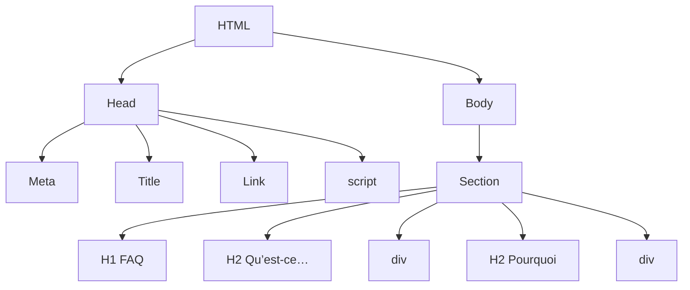
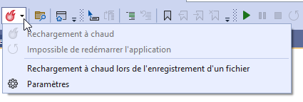

import Laboratoire from '/laboratoire.mdx';

# Introduction à jQuery

## Contenu
- Introduction à jQuery

## Ressources et documentation: 
- [JQuery](https://api.jquery.com/)
- [jQuery Plugin Registry](https://plugins.jquery.com/)  
- [DataTables.net](https://datatables.net/)

### Théorie:  
- 🔗[Notes de cours](#notes-de-cours) (ci-dessous)
- 🔗[420_3W6_cours_19_jQuery.pptx](../assets/cours/presentations/420_3W6_cours_19_jQuery.pptx) (présentation originale)

### Laboratoire
#### GitHub FORK Laboratoire
- Labo 🔗[S19_Lab1_JQuery](https://github.com/A26ProgWebTrans/S19_Lab1_jQuery)

## Notes de cours

### Contenu du cours
- jQuery, c’est quoi?
- Sélecteurs
- Fonctionnalités
- Filtres
- Démo
- Autres jQuery
- Requêtes paginées

### jQuery
- jQuery est une librairie que l’on retrouve partout sur internet. Elle fait presque directement partie de JavaScript, au point où de nombreux programmeurs ne connaissent pas, ou ont du moins oublié, les fonctionnalités de base de JavaScript et utilisent toujours jQuery pour tout.
- jQuery permet d’écrire beaucoup moins de code. Il favorise toujours une syntaxe très courte. Le meilleur exemple, c’est qu’il remplace `document.getElementById("id");` par `$("#id");`.
- jQuery permet également de faire des recherches dans le DOM avec un système de requêtes qui est également très court. Par exemple, `$("#faqs").find("p:eq(2)")` permet d’obtenir l’élément enfant avec l’index 2 (le 3e) de type `p` de l’élément qui a l’id `faqs`. Mais nous allons commencer par des exemples plus simples!

### Sélecteurs jQuery
jQuery permet d’écrire de façon très concise des requêtes pour des éléments. Dans tous les cas, c’est une liste d’éléments qui est retournée; la recherche par id retourne une liste contenant un seul élément.

| Exemple | Description |
|---|---|
| `$("p")` | Tous les éléments `<p>` du document |
| `$("#faqs")` | Un seul élément dont l’id est `faqs` |
| `$(".plus")` | Tous les éléments ayant la classe `plus` |
| `$("#faqs").find("p")` | Tous les descendants `<p>` de `faqs` |
| `$("h2.minus")` | Tous les éléments `<h2>` ayant la classe `minus` |
| `$("h2 + div")` | Adjacents : tous les éléments `<div>` frères collés à un `<h2>` |
| `$("div > ul")` | Tous les éléments `<ul>` enfants directs de `<div>` |
| `$("#faqs li, div p")` | Sélecteurs multiples : tous les descendants `<li>` de `faqs` et tous les descendants `<p>` de `<div>` |
| `$("h2:not(.class)")` | Tous les éléments `<h2>` qui n’ont pas la classe `class` |

Méthode `find` : tous les éléments `<h2>` descendants de l’id `faqs` :

```js
$("#faqs").find("h2")
```

- [jQuery Selectors (site W3Schools)](https://www.w3schools.com/jquery/jquery_selectors.asp)
- [Tous les sélecteurs (site jQuery)](https://api.jquery.com/category/selectors/)

### Fonctionnalités jQuery
```js
let emailAddress2 = $("#email_address2").val();
$("#email_address2_error").text("This field is required.");
$("#email_address1").focus();
```

| Méthode | Description | Exemple |
|---|---|---|
| `val()` | Retourne (get) la valeur d’un champ de formulaire (ex. : `<input>`) | `let nom = $("#nom").val();` |
| `val(value)` | Modifie (set) la valeur d’un champ de formulaire | `$("#nom").val("Alice");` |
| `text()` | Retourne (get) le texte contenu dans un élément HTML | `let titre = $("h1").text();` |
| `text(value)` | Remplace (set) le texte contenu dans un élément HTML | `$("#message").text("Bonjour");` |
| `next("selecteur")` | Retourne le prochain frère (sibling) de l’élément sélectionné si rien n’est spécifié | `$("#nom").next();`<br/>`$("#nom").next("p");` |
| `submit()` | Soumet le formulaire | `$("form").submit();` |
| `focus()` | Place le curseur (le focus) sur un élément de formulaire | `$("#nom").focus();` |

#### Méthodes d’évènements
| Méthode | Description |
|---|---|
| `$(handler)` | Exécute la fonction handler quand le DOM est prêt |
| `on("click", handler)` | Quand on clique sur l’élément sélectionné |

```js
$(function() {
  $("#faqs").find("h2").on("click", function(){
    // Votre code qui s'exécute lorsque l'on clique sur un h2 sous l'élément
    // qui a l'id faqs
  });
});
```

### Des filtres jQuery (liste incomplète)
| Sélecteur | Sélection |
|---|---|
| `[attribute]` | Tous les éléments comportant l’attribut identifié |
| `[attribute=value]` | Tous les éléments comportant l’attribut et la valeur identifiés |
| `:empty` | Tous les éléments qui n’ont pas d’enfant (text inclus) |
| `:first-child` | Tous les 1ers enfants |
| `:header` | Tous les éléments header (`<h1>`, `<h2>`, etc.) |
| `:hidden` | Tous les éléments masqués |
| `:not(selector)` | Tous les éléments qui ne sont pas sélectionnés par un selector |
| `:parent` | Tous les éléments qui ont au moins un enfant (text inclus) |
| `:visible` | Tous les éléments visibles |

| Méthode | Filtrage |
|---|---|
| `first()` | Le 1er élément d’un ensemble |
| `eq(n)` | L’élément à l’indice n d’un ensemble |
| `odd()` | Tous les éléments d’index impair |
| `even()` | Tous les éléments d’index pair |

#### Exemples de filtres
| Code | Sélection |
|---|---|
| `$("li:first-child")` | Tous les `<li>` qui sont le 1er enfant de leur parent |
| `$("table > tr").even()` | Tous les `<tr>` pairs d’une table (départ 0) |
| `$("#faqs").find("p").eq(2)` | Le 3e descendant `<p>` d’un élément (départ 0) |

### Autres méthodes importantes
| Méthode | Sélection | Exemple |
|---|---|---|
| `next([selector])` | Get le prochain frère d’un élément ou le 1er frère du type de selector spécifié | `let prochain = $("#nom").next();`<br/>`let erreur = $("#nom").next(".erreur");` |
| `prev([selector])` | Get le frère précédent d’un élément ou le frère précédent du type de selector spécifié | `let prec = $("#nom").prev();`<br/>`let precP = $("#nom").prev("p");` |
| `attr("attributeName")` | Get la valeur de l’attribut en paramètre | `let src = $("#photo").attr("src");`<br/>`let lien = $("#google").attr("href");` |
| `attr("attributeName", value)` | Set l’attribut en paramètre à la valeur spécifiée | `$("#photo").attr("src", "images/chat.jpg");`<br/>`$("#case").attr("checked", true);` |
| `css("propertyName")` | Get la valeur de la propriété en paramètre | `let couleur = $("#message").css("color");` |
| `css("propertyName", value)` | Set la propriété en paramètre à la valeur spécifiée | `$("#message").css("color", "red");`<br/>`$("#message").css("font-size", "20px");` |
| `addClass("className")` | Ajouter une ou plusieurs classes à un élément | `$("#titre").addClass("colorBlue");` |
| `removeClass("className")` | Supprimer la ou les classes d’un élément | `$("#titre").removeClass("colorBlue");` |
| `toggleClass("className")` | Supprimer la classe si elle existe, sinon ajouter la classe | `$("#titre").toggleClass("colorBlue");` |
| `hide([duration])` | Masquer l’élément sélectionné; paramètre `"slow"` (600 ms), `"fast"` (200 ms) ou nombre de millisecondes (400 ms par défaut) | `$("#faqs").hide("slow");` |
| `show([duration])` | Afficher l’élément sélectionné; idem | `$("#faqs").show(400);` |
| `each(function)` | Exécuter la fonction pour chaque élément d’un array | `$("p").each(function() { console.log($(this).text()); });` |

### Évènements jQuery
| Méthode d’évènement | Sélection |
|---|---|
| `$(handler)` | Exécute la fonction handler quand le DOM est prêt |
| `on("dblclick", handler)` | Quand on double-clique sur un élément |
| `on("mouseenter", handler)` | Quand la souris arrive sur l’élément sélectionné |
| `on("mouseover", handler)` | Quand la souris est sur l’élément sélectionné |
| `on("mouseout", handler)` | Quand la souris quitte l’élément sélectionné |
| `on(event, handler)` | Attache un gestionnaire d’évènement à un évènement |
| `off(event, handler)` | Supprime le gestionnaire d’évènement d’un évènement |
| `one(event, handler)` | Attache un gestionnaire d’évènement à un évènement et le supprime après son exécution |
| `trigger(event)` | Déclenche l’évènement en paramètre |

#### Exemples de gestion d’évènements jQuery
```js
// Assigner un gestionnaire d'évènement à une variable
let effacerClick = function(){}

// Attacher un gestionnaire d'évènement à un évènement
$("#effacer").on("click", effacerClick);

// Déclencher un évènement
$("#effacer").trigger("click");
```

#### Le this dans les évènements
Lors de l’appel de la fonction, on a accès à la variable `this`!

```js
let effacerClick = function(){
  // this est l'élément html sur lequel l'évènement a été enregistré!
  console.log(this);
  // Comme pour n'importe quel élément html,
  // on peut obtenir une version jQuery de cette façon
  console.log($(this));
}
```

#### Le paramètre event dans les évènements
Lors de l’appel de la fonction, on reçoit également un `event` en paramètre.

```js
let effacerClick = function(event){
  // Un évènement reçoit également un paramètre qui donne beaucoup d'information
  // à propos de comment l'évènement a été déclenché.
  // Soyez prudent en l'utilisant!
  // Préférez l'utilisation de this autant que possible.
  // L'event a de nombreuses propriétés qui peuvent être mélangeantes comme:
  // currentTarget, delegateTarget et target
  console.log(event);
}
```

:::note
`this` et l’`event` sont présents dans toutes les méthodes d’évènements avec des callbacks, comme `onmouseover`, `onmouseout`, `onchange`, `onkeydown`, etc.
:::

#### Utiliser le this directement sur l’élément HTML
Si on ajoute directement notre code de callback sur notre élément HTML, le `this` est encore disponible.

```html
<script>
let effacerClick = function(thisElement){
  // Ici, on a reçu en paramètre le this
  console.log(thisElement);
}
</script>
...
<div onclick="effacerClick(this)">
```

#### Convertir en jQuery
Si vous avez un élément HTML normal, c’est possible de le convertir en élément jQuery pour utiliser ses fonctionnalités, comme appeler la méthode `show` ou `hide`, avec un simple `$()`.

```js
let element = document.getElementById("test");
let elementJQuery = $(element);
elementJQuery.hide("slow");
```

À l’inverse, on peut faire la chose suivante (jQuery retourne toujours une collection d’éléments) :

```js
let element = $('#test')[0];
```

### DOM : démo avec jQuery


### Inclure jQuery dans votre page
- Référence : [http://jquery.com](http://jquery.com)

```html
<!-- Référence directe au site -->
<script src="https://code.jquery.com/jquery-3.7.1.min.js"></script>

<!-- Référence à une version téléchargée -->
<script src="js/jquery-3.7.1.min.js"></script>
```

### Requêtes paginées

#### Comment paginer une requête?
Si on considère un objet `filter` qui contient l’information d’un formulaire de recherche avec pagination. Il contient les champs suivants : `SelectedPageIndex` et `ZombieTypeId`, et permet de faire une recherche par `ZombieTypeId` (qui peut être null) et d’afficher uniquement le résultat de la page sélectionnée.

```csharp
int pageIndex = filter.SelectedPageIndex;
int pageSize = 24;
IEnumerable<Zombie> selectedZombies = await this._dbContext.Zombies
    .Where(z => filter.SelectedZombieTypeId == null || z.ZombieTypeId == filter.SelectedZombieTypeId)
    .ToPaginatedAsync(pageIndex, pageSize);
```

#### ToPaginatedAsync
- Cette méthode **static** utilise un premier paramètre **this** et peut donc être appelée sur un objet de type `IQueryable<T>`.
- Le type **générique** de l’objet sur lequel elle est appelée est le même que le type de la liste retournée.
- Un **DbSet** est de type **IQueryable** et les méthodes **Where** et **OrderBy** de **Linq** retournent également un **IQueryable**.
- La méthode **Skip** permet de sauter un certain nombre d’entrées, comme un **offset** dans une requête SQL.
- La méthode **Take** permet de ne pas obtenir plus qu’un certain nombre d’entrées, comme un **limit** dans une requête SQL.

```csharp
public async static Task<IPaginatedList<T>> ToPaginatedAsync<T>(this IQueryable<T> source, int pageIndex, int pageSize)
{
    var result = new PaginatedList<T>();
    result.PageIndex = pageIndex;
    result.PageSize = pageSize;

    // Une requête rapide pour obtenir le nombre d'éléments total
    result.TotalCount = await source.CountAsync();
    result.TotalPages = (int)Math.Ceiling(result.TotalCount / (double)pageSize);

    // Une requête pour obtenir les éléments qui sont sur la page présentée
    result.AddRange(await source.Skip(pageIndex * pageSize).Take(pageSize).ToListAsync());
    return result;
}
```

### Hot Reload
On va modifier souvent nos vues. C’est pour cela qu’on peut utiliser le Hot Reload (rechargement à chaud). Lorsque vous l’activez, vous n’aurez plus à recharger l’application pour voir vos changements.



- [Aperçu de la fonctionnalité (Microsoft Learn)](https://learn.microsoft.com/fr-ca/visualstudio/debugger/hot-reload?view=vs-2022)
