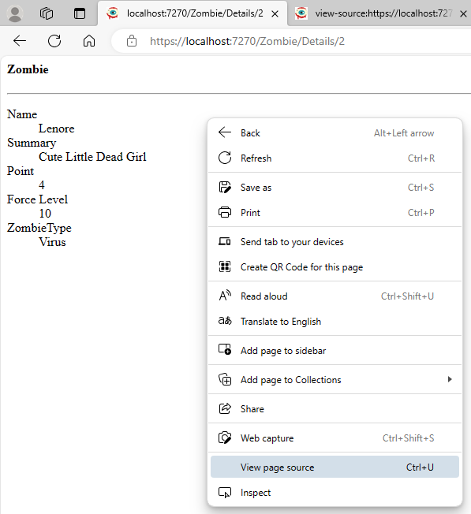
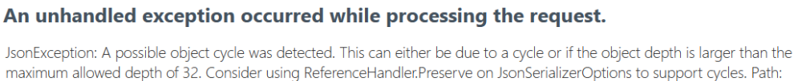

import Laboratoire from '/laboratoire.mdx';

# AJAX (partie 1)

## Contenu
- AJAX #1

## Activités de la séance: 

### Théorie: 
- 🔗[Notes de cours](#notes-de-cours) (ci-dessous)
- 🔗[420_3W6_cours_21_AJAX.pptx](../assets/cours/presentations/420_3W6_cours_21_AJAX.pptx) (présentation originale)

### Laboratoires
#### GitHub FORK Laboratoire
- Labo 1 🔗[S21_Lab1_AJAX](https://github.com/A26ProgWebTrans/S21_Lab1_AJAX)
- Labo 2 🔗[S21_Lab2_AJAX](https://github.com/A26ProgWebTrans/S21_Lab2_AJAX)

---

## Notes de cours

### Contenu du cours
- [Objectif](#objectifs)
- [PartialView](#partialview)
- [jQuery pour PartialView](#jquery-partialview)
- [JsonResult](#jsonresult)
- [Appels AJAX](#appel-ajax-get)
- [jQuery pour JsonResult](#jquery-jsonresult)

### Objectifs
Générer moins qu’une page entière, ce qui est long et complexe :
- Réduire les délais pour l’usager
- Réduire les coûts d’opération du serveur

### PartialView
On a déjà vu l’utilisation de PartialView à l’intérieur d’une vue ou d’une autre PartialView. On peut également retourner une vue partielle dans l’action d’un contrôleur!

```csharp title="Contrôleur"
public async Task<IActionResult> Details(int id)
{
    Zombie zombie = await _serviceZ.GetByIdAsync(id);
    return PartialView("_ZombieDetails", zombie);
}
```

```cshtml title="_ZombieDetails.cshtml"
@model Zombie
<div>
    <h4>Zombie</h4>
    <hr />
    <dl class="row">
        <dt class="col-sm-2">
            @Html.DisplayNameFor(model => model.Name)
        </dt>
        <dd class="col-sm-10">
            @Html.DisplayFor(model => model.Name)
        </dd>
        <dt class="col-sm-2">
            @Html.DisplayNameFor(model => model.ShortDesc)
        </dt>
        <dd class="col-sm-10">
            @Html.DisplayFor(model => model.ShortDesc)
        </dd>
        …
    </dl>
</div>
```

#### Déboguer une PartialView
- On peut accéder directement à l’action du contrôleur (`/Zombie/Details/2`).
- On peut alors visualiser le résultat en version HTML.
- On peut également faire « View page source ».



Voici ce que l’on voit avec « View page source » :

```html
<div>
    <h4>Zombie</h4>
    <hr />
    <dl class="row">
        <dt class="col-sm-2">
            Name
        </dt>
        <dd class="col-sm-10">
            Lenore
        </dd>
        <dt class="col-sm-2">
            Summary
        </dt>
        <dd class="col-sm-10">
            Cute Little Dead Girl
        </dd>
        <dt class="col-sm-2">
            Point
        </dt>
        <dd class="col-sm-10">
            4
        </dd>
        <dt class="col-sm-2">
            Force Level
        </dt>
        <dd class="col-sm-10">
            10
        </dd>
        <dt class="col-sm-2">
            ZombieType
        </dt>
        <dd class="col-sm-10">
            Virus
        </dd>
    </dl>
</div>
```

#### jQuery PartialView
Lorsqu’une action retourne une vue partielle, on peut ajouter les données retournées à notre page en utilisant un appel AJAX `$.get` :

```js
$.get('/Zombie/Details', { "id": id },
    function (htmlData) {
        // la fonction .html permet d'appliquer le contenu reçu par le serveur
        // sur un élément de notre page.
        // Le contenu va être à l'INTÉRIEUR de cet élément.
        $("#details").html(htmlData);
    }
);
```

### Appel AJAX, $.get
On peut faire un appel GET vers le serveur et fournir l’URL, les paramètres et une fonction à exécuter pour traiter la réponse lorsque le serveur va avoir répondu.

```js
$.get('/Zombie/Details', { "id": id },
    function (htmlContent) {
        // Faire quelque chose avec le contenu reçu
        // On utilise fréquemment la fonction .html pour
        // appliquer le résultat sur un élément
    }
)
```

Les 2e et 3e paramètres sont optionnels, mais il faut mettre `null` au 2e paramètre s’il n’y a pas de data.

```js
$.get(url);
$.get(url, data);
$.get(url, data, function{});
$.get(url, null, function{});
```

#### Appel AJAX, $.post
On peut faire les mêmes appels avec la méthode POST. Évidemment, il faut toujours utiliser le type de requête attendu par le serveur.

```js
$.post(url);
$.post(url, data);
$.post(url, data, function{});
$.post(url, null, function{});
```

#### Gestion d’erreurs pour les appels $.get et $.post
Pour gérer les erreurs, il est possible d’ajouter un appel à la fonction `.fail` :

```js
$.get('/Zombie/Details', { "id": id },
    function (data) {
        // Gestion des données
    }
).fail(function (error) {
    // Gestion de l'erreur
    // On peut utiliser la propriété "responseText" pour afficher l'erreur ex:
    console.log(error.responseText);
});
```

### JsonResult
- L’action d’un contrôleur peut retourner n’importe quel type de données qui peut être représenté par un string.
- Lorsque l’on veut retourner un objet, on utilise un encodage qui permet d’écrire l’objet en string et de le retransformer en objet à la réception.
- Lorsque l’on travaille avec JavaScript, le meilleur choix, c’est généralement le format JSON (JavaScript Object Notation). Comme son nom l’indique, c’est un format qui se transforme facilement en objet JavaScript.

#### Exemple JsonResult
Voici un contrôleur qui retourne un JsonResult, et le résultat :

```csharp
[HttpGet]
public async Task<IActionResult> GetZombie(int id)
{
    Zombie? z = await _baseDonnees.Zombies.FindAsync(id);
    if (z != null)
    {
        return Json(z);
    }
    return NotFound("Could not find zombie with id: " + id);
}
```

```json title="https://localhost:7270/Zombie/GetZombie/2"
{
    "zombieType": {
        "id": 2,
        "typeName": "Virus",
        "point": 2,
        "isDisponible": true
    },
    "huntingLogs": [],
    "lazyLoader": {},
    "id": 2,
    "name": "Lenore",
    "shortDesc": "Cute Little Dead Girl",
    "point": 4,
    "force": 10,
    "isFavorite": false,
    "image": "Lenore.png",
    "zombieTypeId": 2
}
```

#### jQuery JsonResult
- Lors d’un appel à une action qui retourne un JsonResult, le résultat reçu est un objet JavaScript construit à partir du JSON reçu.
- Dans cet exemple, on veut obtenir la météo à une coordonnée latitude/longitude. On met ensuite les valeurs à jour sur la page.
- On pourrait penser exécuter cet appel chaque minute, pour que les données de la page soient à jour.

```js
$.get("Meteo/Update/", { "lng": lgn, "lat": lat},
    function (meteoUpdate) {
        $("#temperature").val(meteoUpdate.temperature);
        $("#windSpeed").val(meteoUpdate.windSpeed);
        $("#windDirection").val(meteoUpdate.windDirection);
    }
);
```

### Représentation de relations en JSON
- Dans nos modèles, il y a très fréquemment des relations bidirectionnelles.
- Par exemple, un `Zombie` a un `ZombieType` et un `ZombieType` a plusieurs `Zombies`.
- Comment peut-on écrire un JSON dans ce cas? Voyez-vous le problème?



#### [JsonIgnore]
- Pour s’en sortir, on peut ajouter `[JsonIgnore]` sur n’importe quelle propriété. Ces propriétés ne feront pas partie de la représentation JSON.
- Ça veut également dire que l’objet JS ne possèdera pas ces propriétés du côté du client; on doit donc faire attention à comment on l’utilise.
- Dans l’exemple de Zombie/ZombieType, il faudra le mettre sur la propriété de navigation d’au moins un des côtés.
- Sans autre information, c’est difficile de savoir de quel côté c’est préférable de le mettre; les deux choix ont des avantages et des défauts. On peut donc choisir l’un ou l’autre pour commencer.

### Exemple POST (DTO – Data Transfer Object)
Voici une autre façon de passer nos données à une méthode GET ou POST :

```js
let data = {"id": 1, "newForce": 1000}; // remarquez que l'on commence par une minuscule en JS
$.post(url, data, function);
```

```csharp
public class ZombieForceDTO
{
    public int Id { get; set; }
    public int NewForce { get; set; }
}

[HttpPost]
public async Task<IActionResult> ModifyZombieForce(ZombieForceDTO dto)
{
    Zombie? z = await _baseDonnees.Zombies.FindAsync(dto.Id);
    if (z != null)
    {
        z.Force = dto.NewForce;
        _baseDonnees.SaveChanges();
        return Json(z);
    }
    return NotFound("Could not find zombie with id: " + dto.Id);
}
```

### Exemple POST (HttpParams)
Voici un contrôleur qui modifie un modèle et retourne un JsonResult. Pour l’utiliser, il faut inclure les HttpParams `id` et `newForce` dans l’URL. L’URL complète est donc `/Zombie/ModifyZombieForce?id=X&newForce=Y` OU `/Zombie/ModifyZombieForce/X?newForce=Y` (voir `Program.cs` pour mieux comprendre).

```csharp
[HttpPost]
public async Task<IActionResult> ModifyZombieForce(int id, int newForce)
{
    Zombie? z = await _baseDonnees.Zombies.FindAsync(id);
    if (z != null)
    {
        z.Force = newForce;
        _baseDonnees.SaveChanges();
        return Json(z);
    }
    return NotFound("Could not find zombie with id: " + id);
}
```

### Exemple POST (URL)
La même chose, mais avec les données passées à travers l’URL. L’URL complète est donc `/Zombie/ModifyZombieForce/X/Y`.

:::warning Attention
Cette technique nécessite des changements dans `Program.cs`.
:::

```csharp
[HttpPost("/Zombie/ModifyZombieForce/{id}/{newForce}")]
public async Task<IActionResult> ModifyZombieForce(int id, int newForce)
{
    Zombie? z = await _baseDonnees.Zombies.FindAsync(id);
    if (z != null)
    {
        z.Force = newForce;
        _baseDonnees.SaveChanges();
        return Json(z);
    }
    return NotFound("Could not find zombie with id: " + id);
}
```
