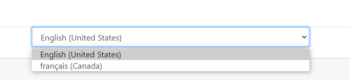
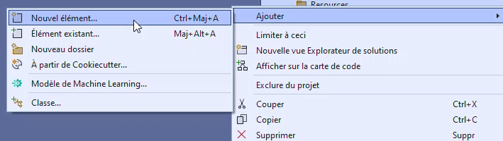
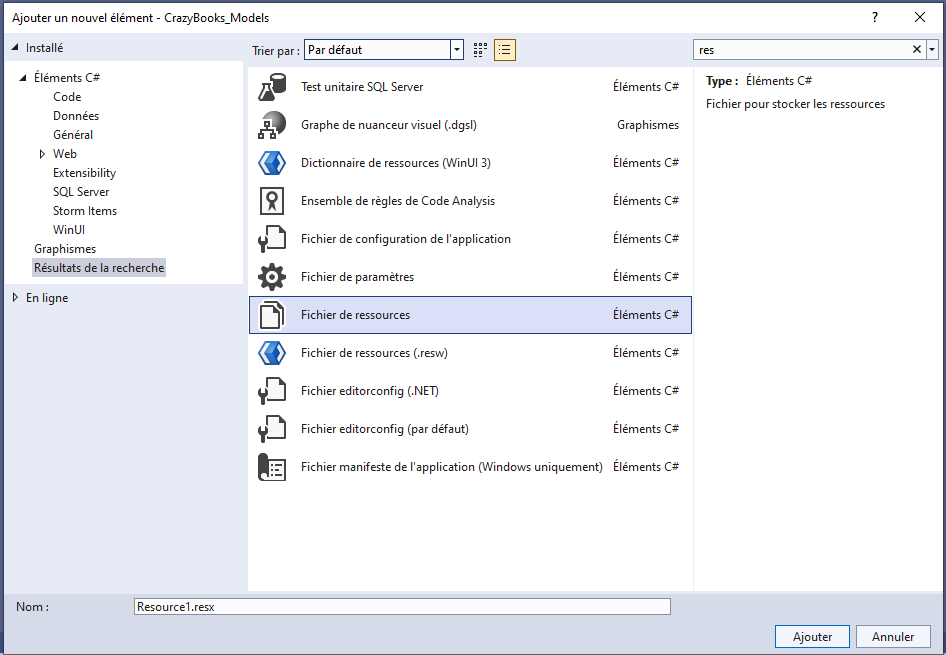
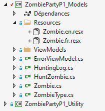
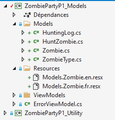

import Laboratoire from '/laboratoire.mdx';

# Internationalisation : concepts et modèles

## Contenu
- Internationalisation i18n concept 
  - Globalisation 
  - Localisation 
  - Validation 
- I18n Models 
  - Traduction: messages erreurs 
  - Traduction : noms des propriétés•	 

## Ressources et documentation: 
- [Globalisation et localisation](https://docs.microsoft.com/en-us/aspnet/core/fundamentals/localization?view=aspnetcore-5.0) 
- [Liste des cultures](https://docwiki.embarcadero.com/RADStudio/Sydney/en/Language_Culture_Names,_Codes,_and_ISO_Values)

## Activités de la séance: 

### Théorie:  
- 🔗[Notes de cours](#notes-de-cours) (ci-dessous)
- 🔗[420_3W6_cours_23_i18n_Modèles.pptx](../assets/cours/presentations/420_3W6_cours_23_i18n_Modèles.pptx) (présentation originale)

### Laboratoire
#### GitHub FORK Laboratoire
- Labo 🔗[S23_Lab_i18n_Models](https://github.com/A26ProgWebTrans/S23_Lab1_i18n)


### Travail personnel:
- Compléter le laboratoire

---

## Notes de cours

### Contenu du cours
- [i18n, c’est quoi?](#internationalisation-i18n)
- [Les cultures](#2-cultures)
- [Traduction](#les-étapes-pour-configurer-la-traduction)

### Internationalisation (i18n)
- **Internationalisation (i18n)** : le processus d’ajouter à l’application le support de différentes langues et régions. Entre autres :
  - $ vs €
  - 19:00 vs 7:00 PM
  - Date
- **Localisation (L10n)** : la personnalisation de l’application pour une langue et une région spécifiques. Surtout :
  - Traduction
  - Modification des images culturelles
- **Globalisation (g11n)** = i18n + L10n, la combinaison des deux
- **Région** : l’endroit où l’utilisateur est situé.
- **Culture neutre** = langue (`fr`) sans région
- **Culture spécifique** = langue + région (`fr-CA`)

### Pourquoi est-ce important de changer les 2?
**Mise en situation :** vous utilisez le site web d’une banque américaine. La banque offre une version française de son site, donc les menus et les messages sont en français.

Par contre, lorsque vous entrez un montant, le site attend toujours le format américain (avec un point pour les décimales, ex. : 2.00). Alors, si vous mettez une virgule (ex. : 2,00), le système peut interpréter la virgule comme un séparateur de milliers et comprendre 2,000 $.

**Pourquoi?** Parce que le `CurrentUICulture` est en français et affiche du texte français, mais le `CurrentCulture`, qui contrôle les formats, est en anglais américain et considère la virgule comme un séparateur de milliers.

### 2 cultures
| Propriété | Rôle |
|---|---|
| `CurrentUICulture` | Obtient ou définit la culture actuelle utilisée par le gestionnaire de ressources pour rechercher des ressources spécifiques à la culture au moment de l’exécution. Utilisée pour obtenir les fichiers de traduction et définit donc le texte affiché (potentiellement différent par région, comme pour le Québec avec `fr-CA`). |
| `CurrentCulture` | Obtient ou définit la culture du thread actuel. Utilisée pour configurer les formats utilisés. Donc pour les dates, les prix, l’heure, etc. |

```csharp
public System.Globalization.CultureInfo CurrentUICulture { get; set; }
public System.Globalization.CultureInfo CurrentCulture { get; set; }
```

#### Responsabilité de chaque culture
| | Modifie les fonctions qui varient selon la culture (ex. : `DateTime.Now.ToShortDateString()`) | Va charger des ressources différentes selon la culture demandée |
|---|---|---|
| `CurrentCulture` | Oui | Non |
| `CurrentUICulture` | Non | Oui |

#### Exemple
On peut voir que changer le `CurrentUICulture` n’a pas d’effet sur la fonction `DateTime.Now.ToShortTimeString()` :

```csharp
Console.Write("Changement du CurrentUICulture : ");
System.Threading.Thread.CurrentThread.CurrentUICulture = new CultureInfo("fr-CA");
Console.Write(DateTime.Now.ToShortTimeString());
Console.Write(" vs ");
System.Threading.Thread.CurrentThread.CurrentUICulture = new CultureInfo("en-US");
Console.WriteLine(DateTime.Now.ToShortTimeString());
```

```text title="Résultat"
Changement du CurrentUICulture : 7:00 PM vs 7:00 PM
```

En modifiant `CurrentCulture`, ça fonctionne!

```csharp
Console.Write("Changement du CurrentCulture : ");
System.Threading.Thread.CurrentThread.CurrentCulture = new CultureInfo("fr-CA");
Console.Write(DateTime.Now.ToShortTimeString());
Console.Write(" vs ");
System.Threading.Thread.CurrentThread.CurrentCulture = new CultureInfo("en-US");
Console.WriteLine(DateTime.Now.ToShortTimeString());
```

```text title="Résultat"
Changement du CurrentCulture : 19:00 vs 7:00 PM
```

### Les étapes pour configurer la traduction
1. Configurer les librairies d’i18n dans le `Program.cs`
2. Mettre un commutateur de langue
3. Traduire les textes des annotations à l’aide de fichiers resx

#### Configuration Program.cs
```csharp title="Program.cs"
var builder = WebApplication.CreateBuilder(args);

#region Langues supportées
CultureInfo[] supportedCultures = new[]
{
    new CultureInfo("en-US"),
    new CultureInfo("fr-CA"),
};
#endregion

// Add services to the container.
// Injecter la localisation ICI
#region Localizer configuration
builder.Services.AddLocalization(options => options.ResourcesPath = "Resources");

builder.Services.AddControllersWithViews()
                .AddViewLocalization(LanguageViewLocationExpanderFormat.Suffix)
                .AddDataAnnotationsLocalization();

builder.Services.Configure<RequestLocalizationOptions>(options =>
{
    options.DefaultRequestCulture = new RequestCulture(culture: "en-US", uiCulture: "en-US");
    options.SupportedCultures = supportedCultures;
    options.SupportedUICultures = supportedCultures;
});
#endregion
```

Il faut également ajouter cette section :

```csharp title="Program.cs"
var app = builder.Build();

var locOptions = app.Services.GetService<IOptions<RequestLocalizationOptions>>();
app.UseRequestLocalization(locOptions.Value);
```

### Ajouter un commutateur de langue


```csharp title="HomeController.cs"
[HttpPost]
public IActionResult SetLanguage(string culture, string returnUrl)
{
    var cookie = CookieRequestCultureProvider.MakeCookieValue(new RequestCulture(culture));
    var name = CookieRequestCultureProvider.DefaultCookieName;
    Response.Cookies.Append(name, cookie, new CookieOptions {
                                              Path = "/",
                                              Expires = DateTimeOffset.UtcNow.AddYears(1),
                                          });

    return LocalRedirect(returnUrl);
}
```

```cshtml title="/Shared/_SelectLanguage.cshtml"
@using Microsoft.AspNetCore.Builder
@using Microsoft.AspNetCore.Mvc.Localization
@using Microsoft.Extensions.Options

@inject IOptions<RequestLocalizationOptions> LocOptions

@{
    var requestCulture = Context.Features.Get<Microsoft.AspNetCore.Localization.IRequestCultureFeature>();
    var cultureItems = LocOptions.Value.SupportedUICultures
        .Select(c => new SelectListItem { Value = c.Name, Text = c.NativeName })
        .ToList();
}

<div style="display: inline-block; vertical-align: middle;">
    <form id="selectLanguage" asp-controller="Home"
          asp-action="SetLanguage" asp-route-returnUrl="@Context.Request.Path@Context.Request.QueryString"
          method="post" class="form-horizontal" role="form">
        <div class="form-group" style="margin-bottom:0">
            <select onchange="this.form.submit()" name="culture" class="form-control btn btn-dark"
                asp-for="@requestCulture.RequestCulture.UICulture.Name" asp-items="cultureItems">
            </select>
        </div>
    </form>
</div>
```

```cshtml title="_Layout.cshtml"
<footer class="border-top footer text-muted">
    <div class="container">
        <div class="row">
            <div class="col-md-6">&copy; 2020 - MaisonReve.Web - <a asp-...>…</a></div>

            <div class="col-md-6 text-right">
                @await Html.PartialAsync("_SelectLanguage")
            </div>
        </div>
    </div>
</footer>
```

### Ajouter les fichiers ressources pour la traduction
Clic droit sur le dossier **Resources** › **Ajouter** › **Nouvel élément…**



Puis choisir **Fichier de ressources** :



Exemple de contenu de `Models.Author.fr.resx` :

| Nom | Valeur |
|---|---|
| EmailAddress | Courriel |
| FirstName | Prénom |
| LastName | Nom |
| MaxCaractersValidation | {0} doit comporter {1} caractères maximum. |
| RequiredValidation | {0} est obligatoire. |

#### Chemin des fichiers de ressources
- Les fichiers de ressources doivent avoir un nom qui inclut les répertoires!
- Si on ajoute un fichier de traduction pour `Zombie` qui est dans le répertoire `Models`, c’est `Models.Zombie."langue".resx`.
- Les DEUX exemples sont valides. Mais dans le 2e cas, la classe `Zombie` est dans le répertoire `Models`.




#### Contenu des fichiers resx
Des dictionnaires avec le texte dans l’application qui est utilisé comme une clé pour accéder au texte traduit.

```csharp title="Zombie.cs"
public class Zombie
{
    public int Id { get; set; }

    [Display(Name = "Name")]
    [StringLength(20, MinimumLength = 5)]
    public string Name { get; set; }

    [Display(Name = "Point")]
    [Range(1, 20, ErrorMessage = "RangeValidation")]
    public int Point { get; set; }
}
```

`Models.Zombie.fr.resx` :

| Nom | Valeur |
|---|---|
| Force | Niveau de force |
| HuntingLogs | Journaux de chasse |
| Image | Photo |
| Name | Nom |
| Point | Point |
| ShortDesc | Résumé |
| RangeValidation | {0} doit avoir une valeur entre {1} et {2}. |
| Zombie | Zombie |
| ZombieType | Type |
