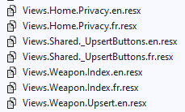
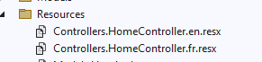
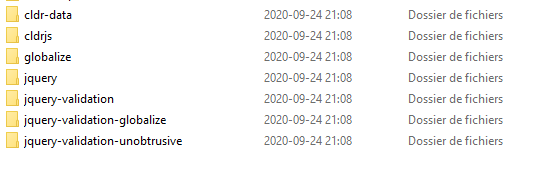

import Laboratoire from '/laboratoire.mdx';

# Internationalisation : vues et ViewModels

## Contenu
- Internationalisation i18n 
  - Traduction Views
  - Traduction ViewModels

## Ressources et documentation: 
- [Globalisation et localisation](https://docs.microsoft.com/en-us/aspnet/core/fundamentals/localization?view=aspnetcore-5.0) 
- [Liste des cultures](https://docwiki.embarcadero.com/RADStudio/Sydney/en/Language_Culture_Names,_Codes,_and_ISO_Values)

## Activités de la séance: 

### Théorie:  
- 🔗[Notes de cours](#notes-de-cours) (ci-dessous)
- 🔗[420_3W6_cours_24_i18n_Vues_Contrôleurs.pptx](../assets/cours/presentations/420_3W6_cours_24_i18n_Vues_Contrôleurs.pptx) (présentation originale)

### Laboratoire
#### GitHub FORK Laboratoire
- Labo 🔗[S24_Lab_i18n_Views](https://github.com/valerieturgeon/S24_Lab1_i18n_part2)


### Travail personnel:
- Compléter le laboratoire

## Notes de cours

### Contenu du cours
- Vues et contrôleurs
- IStringLocalizer
- IViewLocalizer, TagHelpers et _ViewImports
- Résumé i18n

### Vues et contrôleurs
On a déjà vu comment traduire nos modèles; c’est maintenant le moment d’apprendre comment traduire nos vues et nos contrôleurs.

Tout d’abord, il faut créer des fichiers de traduction `.resx` comme pour les modèles. Le nom des fichiers est important et il doit encore correspondre au chemin du fichier que l’on veut traduire.




### IStringLocalizer
- On doit tout d’abord l’injecter. On peut utiliser la technique d’injection de notre choix; dans l’exemple, on l’ajoute comme paramètre à notre constructeur.
- Il faut spécifier le contrôleur que l’on traduit : `IStringLocalizer<MyController>`.
- On l’utilise ensuite comme un dictionnaire en utilisant la clé qui se trouve dans le fichier `.resx`.

```csharp title="HomeController.cs"
public HomeController(ILogger<HomeController> logger, IStringLocalizer<HomeController> localizer)
{
    _logger = logger;
    _localizer = localizer;
}

public IActionResult Index()
{
    ViewData["Title"] = this._localizer["HomeIndexTitle"];
    return View();
}
```

### IViewLocalizer
- Pour utiliser le `IViewLocalizer`, l’équivalent du `IStringLocalizer` pour nos vues, on doit également l’injecter. On utilise `@inject` pour injecter dans une vue.
- On peut faire une injection directement dans la vue que l’on veut traduire, mais on peut également le faire dans `_ViewImports.cshtml`. Le contenu de `_ViewImports.cshtml` est inclus dans toutes les vues.
- Encore une fois, on l’utilise simplement comme un dictionnaire avec les clés du fichier `.resx`.

```cshtml title="_ViewImports.cshtml"
@addTagHelper *, Microsoft.AspNetCore.Mvc.TagHelpers.Localization
@using Microsoft.AspNetCore.Mvc.Localization
@inject IViewLocalizer Locals
```

```cshtml title="Views/Home/Index.cshtml"
<div class="text-center">
    <h1 class="display-4">@Locals["Welcome"]</h1>
    <p>@Locals["WelcomeMessage"]</p>
</div>
```

:::warning Attention
Même si on injecte dans `_ViewImports`, le fichier `.resx` doit avoir le chemin de la vue où il est utilisé!
:::

### Résumé i18n
1. Configurer les librairies d’i18n dans le `Program.cs`
   - IViewLocalizer TagHelpers
2. Mettre un commutateur de langue
3. Importer et utiliser les `IViewLocalizer`
4. Importer et utiliser les `IStringLocalizer<T>`
5. Traduire les textes des annotations à l’aide de resx
6. Traduire les textes des vues
7. Traduire les textes des contrôleurs

### Validation des décimales sur le client avec i18n
jQuery Validation utilise les décimales avec un point, tandis que notre serveur utilise les décimales avec une virgule lorsqu’il est en français… Problème! Aucune décimale ne fonctionnera quand on est en français!

Pour que jQuery utilise le bon résultat, il faut ajouter des librairies JavaScript : **cldr** et **globalize**.



#### Librairies cldr et Globalize
- **cldr** : un module qui permet d’extraire de nombreuses informations propres à une région à partir du Unicode CLDR (Common Localization Data Repository), entre autres :
  - Formats de date, d’heure et de date-heure
  - Formats d’intervalles de dates
  - Formats de nombres, symboles et chiffres pour tous les systèmes de numération
  - Noms des jours, des mois, des trimestres, etc.
  - Noms d’affichage pour les langues, fuseaux horaires, territoires et devises
  - Règles de pluriel et formatage des nombres (convertis en fonctions JavaScript)
- **jQuery.Validation.Globalize** : une extension du plugin jQuery Validation qui lui fait utiliser Globalize pour l’analyse des nombres et des dates (ce qui permet une validation internationalisée simple).

#### Modification pour la validation client
Il faut modifier `_ValidationScriptsPartial`, mais ne vous en faites pas trop, on vous fournit une version fonctionnelle dans le laboratoire!

```cshtml title="_ValidationScriptsPartial.cshtml"
<!-- cldr scripts (needed for globalize) -->
<script src="~/lib/cldrjs/cldr.js"></script>
<script src="~/lib/cldrjs/cldr/event.js"></script>
<script src="~/lib/cldrjs/cldr/supplemental.js"></script>

<!-- globalize scripts -->
<script src="~/lib/globalize/globalize.js"></script>
<script src="~/lib/globalize/globalize/number.js"></script>
<script src="~/lib/globalize/globalize/date.js"></script>

<script src="~/lib/jquery-validation-globalize/jquery.validate.globalize.js"></script>


@inject Microsoft.AspNetCore.Hosting.IWebHostEnvironment HostingEnvironment
@{
    string GetDefaultLocale()
    {
        const string localePattern = "lib\\cldr-data\\main\\{0}";
        var currentCulture = System.Globalization.CultureInfo.CurrentCulture;
        var cultureToUse = "en"; //Default regionalisation to use

        if (System.IO.Directory.Exists(System.IO.Path.Combine(HostingEnvironment.WebRootPath, string.Format(localePattern, currentCulture.Name))))
            cultureToUse = currentCulture.Name;
        else if (System.IO.Directory.Exists(System.IO.Path.Combine(HostingEnvironment.WebRootPath, string.Format(localePattern, currentCulture.TwoLetterISOLanguageName))))
            cultureToUse = currentCulture.TwoLetterISOLanguageName;

        return cultureToUse;
    }
}
<script type="text/javascript">
    var culture = "@GetDefaultLocale()";
    $.when(
        $.get("/lib/cldr-data/supplemental/likelySubtags.json"),
        $.get("/lib/cldr-data/main/" + culture + "/numbers.json"),
        $.get("/lib/cldr-data/supplemental/numberingSystems.json"),
        $.get("/lib/cldr-data/main/" + culture + "/ca-gregorian.json"),
        $.get("/lib/cldr-data/main/" + culture +"/timeZoneNames.json"),
        $.get("/lib/cldr-data/supplemental/timeData.json"),
        $.get("/lib/cldr-data/supplemental/weekData.json")
    ).then(function () {
        // Normalize $.get results, we only need the JSON, not the request statuses.
        return [].slice.apply(arguments, [0]).map(function (result) {
            return result[0];
        });
    }).then(Globalize.load).then(function () {
        Globalize.locale(culture);
    });
</script>
```
