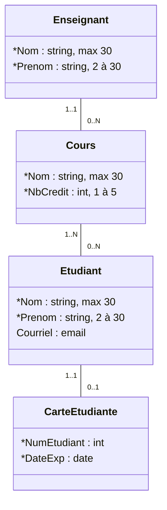
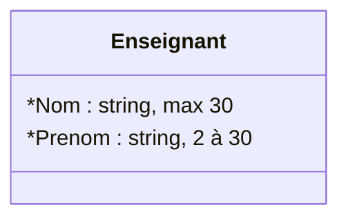
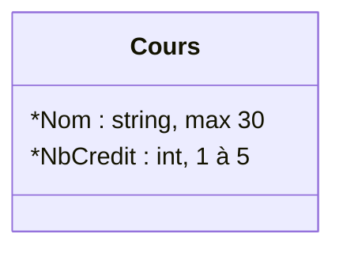
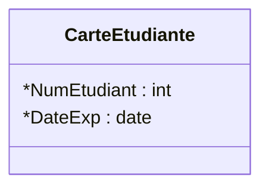
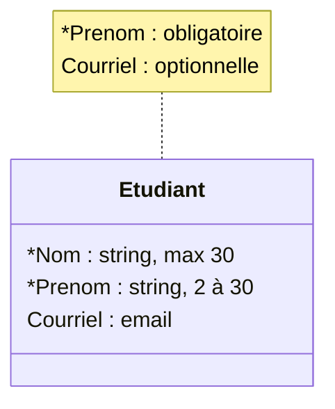
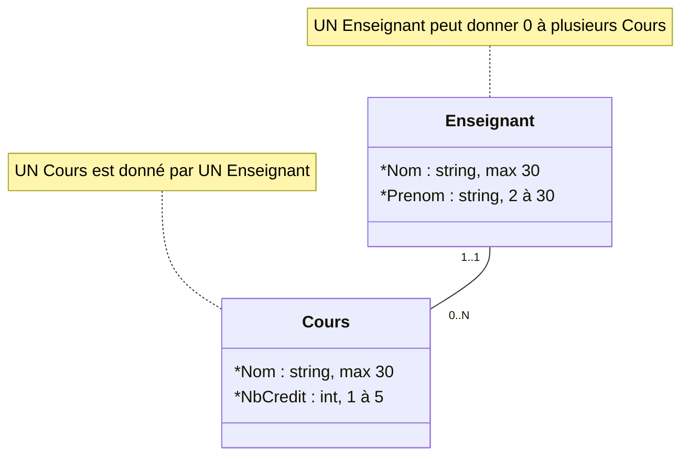
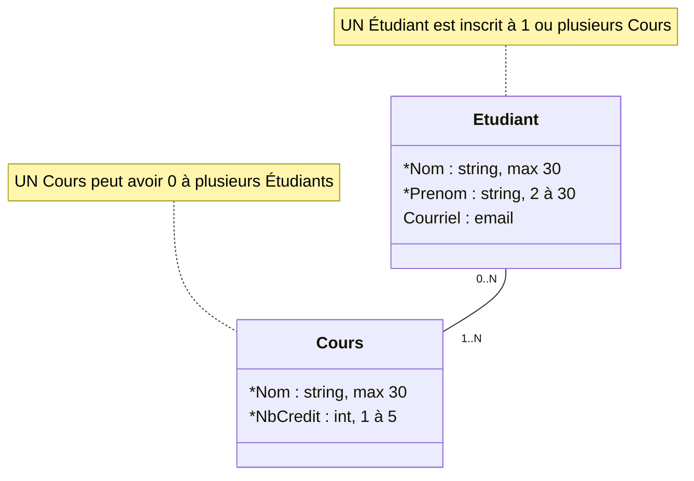
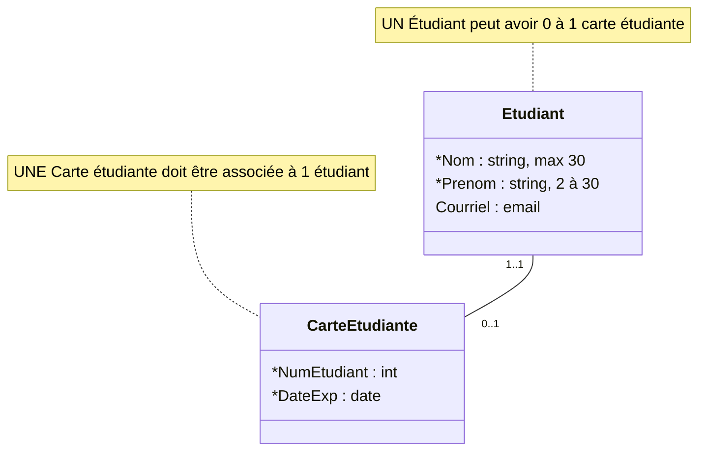

# Créer la base de données à partir du modèle de classes


Cette section présente les étapes permettant de créer la base de données en utilisant Asp.net Core et Entity Framework. Pour davantage de détails sur la nomenclature utilisée, référez-vous aux rencontres 3 et 4.    

Le diagramme que nous allons utiliser est le suivant. On y retrouve les **3 types de relations** (un à un, un à plusieurs et plusieurs à plusieurs). 



:::tip
Nous avons ajouté peu de propriétés pour alléger le contenu du diagramme. 
:::

## Étape 1. Création des modèles dans l'application 

Dans l'application, faire un clic droit sur le **répertoire Models pour ajouter les classes**. Nous obtenons alors le résultat suivant :  

```text
Models
├── Data
    └── DbContet.cs
├── CarteEtudiante.cs
├── Cours.cs
├── Enseignant.cs
├── ErrorViewModel.cs
└── Etudiant.cs
```

## Étape 2. Ajouter les propriétés et les annotations

### **Modèle Enseignant** : 
- On remarque ici **deux utilisations différentes de StringLength** avec une taille minimale ou non.



Devient :

```csharp title="Enseignant.cs"
public class Enseignant
{
    [StringLength(30)]
    public string Nom { get; set; }

    [StringLength(30, MinimumLength = 2)]
    public string Prenom { get; set; }
}
```

### **Modèle Cours** : 
- Ici, nous utilisons **Range** pour les **int**. 



Devient :

```csharp title="Cours.cs"
public class Cours
{
    [StringLength(30)]
    public string Nom { get; set; }

    [Range(1,5)]
    public int NbCredit { get; set; }
}
```

### **Modèle CarteEtudiante** :
- Ici, nous utilisons **DateTime** pour les dates.  



Devient :

```csharp title="CarteEtudiante.cs"
public class CarteEtudiante
{
    public int NumEtudiant { get; set; }
    public DateTime DateExp { get; set; }
}
```

### **Modèle Etudiant** : 
- Ici, nous faisons la distinction **entre les propriétés obligatoires et celles qui sont optionnelles**. 



Devient :

```csharp title="Etudiant.cs"
public class Etudiant
{
    [StringLength(30)]
    public string Nom { get; set; }

    [StringLength(30, MinimumLength = 2)]
    public string Prenom { get; set; }

    [EmailAddress]
    public string? Courriel { get; set; }
}
```

:::warning Attention
Dans le modèle de classe, **les propriétés obligatoires** sont représentées avec un astérisque (`*`). **Les propriétés optionnelles**, quant à elles, n’ont pas d’astérisque. Il faut donc ajouter un `?` après le type de cette propriété. Ici, c’est le cas pour la **propriété Courriel**.
:::

- **Annotation [Required]** : Pour les **propriétés obligatoires**, vous n'êtes pas obligé d'ajouter **l'annotation [Required]** à vos propriétés. Par défaut, les propriétés non optionnelles sont considérées comme requises. 

## Étape 3. Ajouter la clé primaire dans chacun des modèles : 
- Dans l'exemple suivant, nous avons ajouté la **clé primaire Id au modèle Enseignant et l'annotation [key]**. Il faut le faire pour tous les modèles. 

```csharp title="Enseignant.cs"
public class Enseignant
{
    // highlight-start
    [Key]
    public int Id { get; set; }
    // highlight-end

    [StringLength(30)]
    public string Nom { get; set; }

    [StringLength(30, MinimumLength = 2)]
    public string Prenom { get; set; }
}
```

## Étape 4. Ajouter les relations entre les modèles et les clés étrangères : 

- Voici une façon de procéder pour représenter les relations 

### 1. Relation Un à Plusieurs : 

- Dans le diagramme nous avons une relation **Un à Plusieurs** entre les modèles **Enseignant** et **Cours**. 



```csharp title="Cours.cs"
public class Cours
{
    [Key]
    public int Id { get; set; }

    [StringLength(30)]
    public string Nom { get; set; }

    [Range(1, 5)]
    public int NbCredit { get; set; }

    // highlight-start
    // Clé étrangère (côté « plusieurs » de la relation)
    [ForeignKey("Enseignant")]
    public int EnseignantId { get; set; }

    // Propriété de navigation
    [ValidateNever]
    public Enseignant Enseignant { get; set; }
    // highlight-end
}
```
:::note
Puisqu’un Cours est donné par **un** Enseignant, nous devons ajouter une **propriété `Enseignant`** dans le modèle **Cours**.
:::

```csharp title="Enseignant.cs"
public class Enseignant
{
    [Key]
    public int Id { get; set; }

    [StringLength(30)]
    public string Nom { get; set; }

    [StringLength(30, MinimumLength = 2)]
    public string Prenom { get; set; }

    // highlight-start
    // Propriété de navigation
    [ValidateNever]
    public List<Cours>? Cours { get; set; }
    // highlight-end
}
```

:::note
Puisqu’un Enseignant peut donner **0 à plusieurs** Cours, nous devons ajouter une **liste de `Cours`** dans le modèle **Enseignant**. Nous ajoutons aussi le `?` puisque la relation est **optionnelle**.
:::

:::tip Clé étrangère
Dans la relation **un à plusieurs**, la clé étrangère doit être placée du côté **« plusieurs »** de la relation. Donc, nous devons placer la clé étrangère `EnseignantId` dans le **modèle Cours**. Nous ajoutons aussi l’annotation `[ForeignKey("Enseignant")]`.
:::

:::warning Attention
Remarquez **l'annotation [ValidateNever]** sur **les propriétés de navigation**. Il faut ajouter cette annotation sur **chacune des propriétés de navigation** pour éviter des problèmes de validation au niveau du **ModelState.IsValid**. 
:::

### 2. Relation Plusieurs à Plusieurs : 

- Dans le diagramme nous avons une relation **Plusieurs à Plusieurs** entre les modèles **Etudiant** et **Cours**. 


```csharp title="Etudiant.cs"
public class Etudiant
{
    [Key]
    public int Id { get; set; }

    [StringLength(30)]
    public string Nom { get; set; }

    [StringLength(30, MinimumLength = 2)]
    public string Prenom { get; set; }

    [EmailAddress]
    public string? Courriel { get; set; }

    // highlight-start
    // Propriété de navigation ajoutée
    [ValidateNever]
    public List<Cours> Cours { get; set; }
    // highlight-end
}
```
:::note
Puisqu’un Étudiant est inscrit à **1 ou plusieurs** Cours, nous devons ajouter une **liste de `Cours`** dans le modèle **Etudiant**.
:::

```csharp title="Cours.cs"
public class Cours
{
    [Key]
    public int Id { get; set; }

    [StringLength(30)]
    public string Nom { get; set; }

    [Range(1, 5)]
    public int NbCredit { get; set; }

    [ForeignKey("Enseignant")]
    public int EnseignantId { get; set; }

    [ValidateNever]
    public Enseignant Enseignant { get; set; }

    // highlight-start
    // Propriété de navigation ajoutée
    [ValidateNever]
    public List<Etudiant>? Etudiants { get; set; }
    // highlight-end
}
```
:::note
Puisqu’un Cours peut avoir **0 à plusieurs** étudiants, nous devons ajouter une **liste d’`Etudiant`** dans le modèle **Cours**. Nous ajoutons aussi le `?` puisque la relation est **optionnelle**.
:::

:::warning Clé étrangère
Dans cette relation, nous n’avons pas à ajouter de clés étrangères. 
:::

:::tip Table associative
Puisqu’il s’agit d’une relation **Plusieurs à Plusieurs**, Entity Framework va générer pour nous une table associative dans la base de données. Si nous voulions stocker des informations supplémentaires entre ces deux modèles, par exemple la note de l’étudiant, il faudrait nous-même créer un modèle qui représenterait la table associative et qui aurait des relations avec Etudiant et Cours. 
:::

### 3. Relation Un à Un : 

- Dans le diagramme nous avons une relation **Un à Un** entre les modèles **Etudiant** et **CarteEtudiante**. 



Puisqu’un étudiant peut avoir **0 à 1** carte étudiante, nous devons ajouter une **propriété `CarteEtudiante`** dans le modèle **Etudiant**. Nous ajoutons aussi le `?` puisque la relation est **optionnelle**.

```csharp title="Etudiant.cs"
public class Etudiant
{
    [Key]
    public int Id { get; set; }

    [StringLength(30)]
    public string Nom { get; set; }

    [StringLength(30, MinimumLength = 2)]
    public string Prenom { get; set; }

    [EmailAddress]
    public string? Courriel { get; set; }

    [ValidateNever]
    public List<Cours> Cours { get; set; }

    // highlight-start
    // Propriété de navigation ajoutée
    [ValidateNever]
    public CarteEtudiante? CarteEtudiante { get; set; }
    // highlight-end
}
```

Puisqu’une carte étudiante doit appartenir à **1** étudiant, nous devons ajouter une **propriété `Etudiant`** dans le modèle **CarteEtudiante**.

```csharp title="CarteEtudiante.cs"
public class CarteEtudiante
{
    [Key]
    public int Id { get; set; }
    public int NumEtudiant { get; set; }
    public DateTime DateExp { get; set; }

    // highlight-start
    // Clé étrangère (côté optionnel de la relation)
    [ForeignKey("Etudiant")]
    public int EtudiantId { get; set; }

    // Propriété de navigation ajoutée
    [ValidateNever]
    public Etudiant Etudiant { get; set; }
    // highlight-end
}
```
:::tip Clé étrangère
Dans la relation **un à un**, il faut ajouter **une seule clé étrangère**, sinon Entity Framework lancera une erreur. La clé étrangère peut être placée des deux côtés de la relation, mais **nous la plaçons du côté optionnel de la relation**. Donc, nous ajoutons `EtudiantId` dans le modèle **CarteEtudiante**.
:::

## Étape 5. Ajouter les DbSets dans le DbContext: 

- **Pour chaque modèle** ajouté, il faut ajouter un **DbSet dans le DbContext**.

```csharp title="ExRelationDbContext.cs"
public class ExRelationDbContext : DbContext
{
    public ExRelationDbContext(DbContextOptions<ExRelationDbContext> options)
        : base(options)
    {
    }

    public DbSet<Cours> Cours { get; set; }
    public DbSet<Enseignant> Enseignants { get; set; }
    public DbSet<Etudiant> Etudiants { get; set; }
    public DbSet<CarteEtudiante> CarteEtudiantes { get; set; }
}
```

## Étape 6. Créer la migration et la base de données :

1. Dans la **console de gestionnaire de package**, faites la commande suivante pour **créer la migration**. 

```
add-migration nom_migration
```

-   Assurez-vous que la migration a été créée et qu'elle **n'est pas vide** (exemple du fichier de migration avec contenu partiel). 

```text
Migrations
└── 20251017234959_Ajout_Models.cs
```

```csharp title="20251017234959_Ajout_Models.cs (extrait)"
public partial class Ajout_Models : Migration
{
    /// <inheritdoc />
    protected override void Up(MigrationBuilder migrationBuilder)
    {
        migrationBuilder.CreateTable(
            name: "Enseignants",
            columns: table => new
            {
                Id = table.Column<int>(type: "int", nullable: false)
                    .Annotation("SqlServer:Identity", "1, 1"),
                Nom = table.Column<string>(type: "nvarchar(30)", maxLength: 30, nullable: false),
                Prenom = table.Column<string>(type: "nvarchar(30)", maxLength: 30, nullable: false)
            },
            // ...
```


2. **Créez la base de données** avec la commande suivante 

```
update-database
```

- Regardez dans **l'explorateur d'objets SQL** si la base de données a été créée et si les tables existent.

:::tip Ouvrir l’explorateur d’objets SQL Server dans Visual Studio
1. Menu **Affichage** › **Explorateur d’objets SQL Server**.
2. Dépliez **SQL Server** › **(localdb)\MSSQLLocalDB** › **Bases de données** › *le nom de votre BD* › **Tables**.
3. Si la base de données ou une table n’apparaît pas, cliquez sur le bouton **Actualiser** en haut de l’explorateur.
:::

:::info Ouvrir la BD avec SQL Server Management Studio (SSMS)
On peut aussi ouvrir la base de données dans **SSMS** à l’aide des informations de la chaîne de connexion (`ConnectionStrings` dans `appsettings.json`) :
- **Nom du serveur** : la valeur de `Server=`, par exemple `(localdb)\MSSQLLocalDB`
  - Attention : dans `appsettings.json`, on voit `(localdb)\\MSSQLLocalDB` avec **deux** barres obliques inverses. En JSON, `\` est un caractère d’échappement, donc `\\` représente **une seule** barre `\`. Dans SSMS, il faut donc écrire `(localdb)\MSSQLLocalDB` avec **une seule** barre.
- **Authentification** : **Authentification Windows** (car `Trusted_Connection=True`)
- Une fois connecté, la BD se trouve dans **Bases de données** sous le nom indiqué par `Database=`.

Si la connexion échoue à cause du chiffrement, cochez **Faire confiance au certificat du serveur**.
:::

```text
SQL Server
└── (localdb)\MSSQLLocalDB
    └── Bases de données
        └── Exemple_Relations
            └── Tables
                ├── dbo.__EFMigrationsHistory
                ├── dbo.CarteEtudiantes
                ├── dbo.Cours
                ├── dbo.CoursEtudiant
                ├── dbo.Enseignants
                └── dbo.Etudiants
```

:::info Remarque 
ici qu'Entity Framework a créé une **table associative CoursEtudiant** puisqu'il y avait une relation **Plusieurs à Plusieurs** entre les tables Cours et Etudiant.
:::
